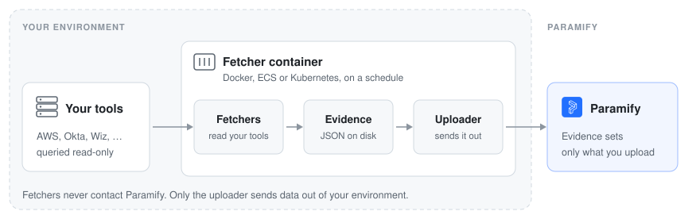
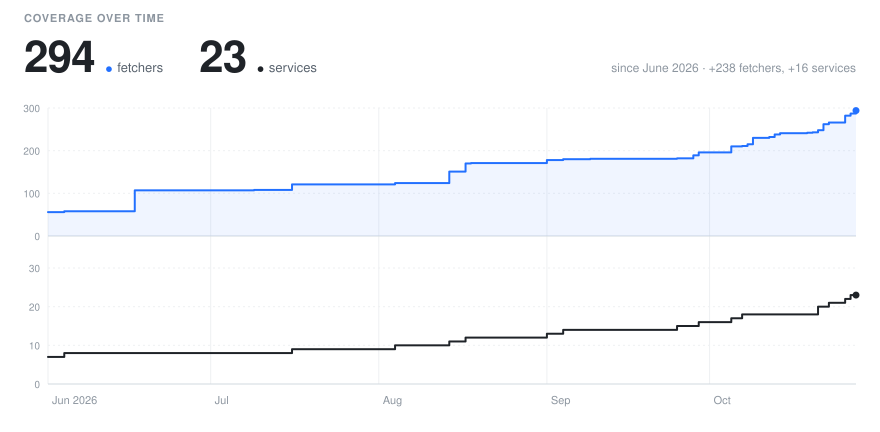
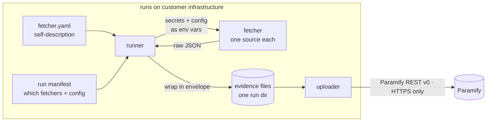

# Paramify Fetchers

[](https://github.com/paramify/paramify-fetchers/actions/workflows/ci.yml)
[](LICENSE)
[](pyproject.toml)
[](CHANGELOG.md)
[](https://deepwiki.com/paramify/paramify-fetchers)

Fetchers are small scripts that collect compliance evidence from your infrastructure and write it to disk as JSON. A separate uploader stage pushes that evidence to Paramify. This repo contains the fetchers, the runner that executes them, and the uploader — the fetchers themselves never talk to Paramify directly.

<div align="center">

<picture><source media="(prefers-color-scheme: dark)" srcset="docs/img/readme/how-it-works-dark.svg"></picture>

</div>

---

## Supported services

<div align="center">

<table>
  <tr>
    <td align="center" width="128"><a href="fetchers/aws/"><picture><source media="(prefers-color-scheme: dark)" srcset="fetchers/logos/aws-dark.svg"></picture></a><br><sub>AWS</sub></td>
    <td align="center" width="128"><a href="fetchers/azure/"></a><br><sub>Azure</sub></td>
    <td align="center" width="128"><a href="fetchers/gcp/"></a><br><sub>Google Cloud</sub></td>
    <td align="center" width="128"><a href="fetchers/wiz/"></a><br><sub>Wiz</sub></td>
    <td align="center" width="128"><a href="fetchers/datadog/"></a><br><sub>Datadog</sub></td>
    <td align="center" width="128"><a href="fetchers/okta/"><picture><source media="(prefers-color-scheme: dark)" srcset="fetchers/logos/okta-dark.svg"></picture></a><br><sub>Okta</sub></td>
  </tr>
  <tr>
    <td align="center" width="128"><a href="fetchers/crowdstrike/"></a><br><sub>CrowdStrike</sub></td>
    <td align="center" width="128"><a href="fetchers/splunk/"></a><br><sub>Splunk</sub></td>
    <td align="center" width="128"><a href="fetchers/sentinelone/"></a><br><sub>SentinelOne</sub></td>
    <td align="center" width="128"><a href="fetchers/knowbe4/"></a><br><sub>KnowBe4</sub></td>
    <td align="center" width="128"><a href="fetchers/gitlab/"></a><br><sub>GitLab</sub></td>
    <td align="center" width="128"><a href="fetchers/k8s/"></a><br><sub>Kubernetes</sub></td>
  </tr>
  <tr>
    <td align="center" width="128"><a href="fetchers/rippling/"><picture><source media="(prefers-color-scheme: dark)" srcset="fetchers/logos/rippling-dark.svg"></picture></a><br><sub>Rippling</sub></td>
    <td align="center" width="128"><a href="fetchers/paramify/"></a><br><sub>Paramify</sub></td>
    <td align="center" width="128"><a href="fetchers/checkov/"></a><br><sub>Checkov</sub></td>
    <td align="center" width="128"><a href="fetchers/servicenow/"></a><br><sub>ServiceNow</sub></td>
    <td align="center" width="128"><a href="fetchers/betterstack/"><picture><source media="(prefers-color-scheme: dark)" srcset="fetchers/logos/betterstack-dark.svg"></picture></a><br><sub>Better Stack</sub></td>
    <td align="center" width="128"><a href="fetchers/jira/"></a><br><sub>Jira</sub></td>
  </tr>
</table>

</div>

<!-- BEGIN:fetcher-chart -->
<div align="center">

<picture><source media="(prefers-color-scheme: dark)" srcset="docs/coverage-over-time-dark.svg"></picture>

</div>

Generated from this repo's git history by `python tools/generate_chart.py`, and refreshed by CI whenever a fetcher lands.
<!-- END:fetcher-chart -->

### Coming soon

More integrations are in progress. To ask for a new platform or fetcher, or upvote what should come next, use [Fetcher requests](https://github.com/paramify/paramify-fetchers/discussions/categories/fetcher-requests) in Discussions.

<div align="center">

<table>
  <tr>
    <td align="center" width="128"><br><sub>SSL Labs</sub></td>
    <td align="center" width="128"><picture><source media="(prefers-color-scheme: dark)" srcset="fetchers/logos/github-dark.svg"></picture><br><sub>GitHub</sub></td>
    <td align="center" width="128"><picture><source media="(prefers-color-scheme: dark)" srcset="fetchers/logos/tenable-dark.svg"></picture><br><sub>Tenable</sub></td>
  </tr>
</table>

<sub>and more</sub>

</div>

---

## Install

**Prerequisites:** Python 3.10+. The CLIs your fetchers need (`aws`, `jq`, `curl`, `kubectl`, etc.) must be on your `PATH` — install only what applies to the categories you'll run. Most services have a credential setup guide at `fetchers/<category>/README.md`; [Where to read next](#where-to-read-next) lists them.

```bash
git clone https://github.com/paramify/paramify-fetchers.git
cd paramify-fetchers
python -m venv .venv && source .venv/bin/activate
pip install -e '.[all]'      # '[all]' bundles the TUI; use `pip install -e .` for the headless CLI only
```

Azure and GCP are the exceptions to the CLI rule above: both talk to their cloud
through the official SDKs rather than a CLI, so each has its own extra and
neither needs a cloud CLI at runtime.

```bash
pip install -e '.[azure]'    # 32 packages; no `az` CLI at runtime
pip install -e '.[gcp]'      # 12 packages; no `gcloud` at runtime
```

Both are deliberately kept out of `[all]` — they are the heaviest extras here
and only matter if you actually run those categories. Azure authenticates
through `DefaultAzureCredential`, GCP through Application Default Credentials;
neither takes a static key file.

There are three ways to drive it — an interactive **TUI**, an **AI agent**, or the **CLI** directly. All three go through one facade (`framework.api`), so they behave identically; pick whichever fits how you work.

---

## The TUI

The fastest way in. `paramify tui` browses the catalog, builds and validates a
manifest, runs it, and reviews evidence — all without leaving the keyboard:


**Sending scan reports** (Nessus, Wiz, STIG results and the like) into Paramify
pipelines is its own short setup — a manifest for the scanners, an assessment and
close policy for each, then send from the Paramify tab. The walkthrough, with
recordings, is [`docs/pipelines_guide.md`](docs/pipelines_guide.md).

> **Zero-credential first run:** the bundled `demo_hello` fetcher emits synthetic
> evidence, so you can watch the whole collect → envelope pipeline before wiring
> up a real service:
>
> ```bash
> paramify run examples/demo.yaml                    # synthetic evidence — no credentials
> paramify evidence evidence/run-*/demo_hello.json   # inspect the enveloped result
> ```

The recordings on this page were made against a larger set of synthetic fetchers
than the repo ships, so a run of your own will be shorter than the one on film —
`examples/demo.yaml` collects once and exits clean. What the frames show of the
runner, the envelope and each command's output is exactly what you get.


---

## Drive it with an AI agent

Every command takes `--json`, and each `paramify manifest` edit returns a stable
`{ok, path, errors}` object — so an agent can assemble a runnable manifest by
reading `errors` and closing each gap, no screen-scraping:

```bash
paramify catalog --json                                  # discover what's available
paramify manifest add okta_phishing_resistant_mfa --json # → {"ok": false, "errors": [ …missing secrets… ]}
paramify manifest set-secret okta_phishing_resistant_mfa api_token OKTA_API_TOKEN --json
# …repeat until:
paramify validate manifest.yaml --json                   # → {"ok": true, "errors": []}
```

The repo also ships Claude Code skills under [`.claude/skills/`](.claude/skills/) —
`create-fetcher`, `onboard-platform`, `wire-manifest`, and `suggest-validator` — so
an agent can scaffold a new fetcher, onboard a platform nobody has integrated yet,
wire a fetcher into a manifest, or propose a validator directly.

---

## Using the CLI

The same operations, run by hand. `paramify catalog` lists the catalog and
`paramify describe <fetcher>` shows exactly what any one fetcher needs:


A typical run, step by step:

```bash
# 1. Browse available fetchers by category
paramify catalog

# 2. Start a manifest and wire in your fetchers
paramify manifest init
paramify manifest add okta_phishing_resistant_mfa
paramify manifest set-secret okta_phishing_resistant_mfa api_token OKTA_API_TOKEN
paramify manifest set-secret okta_phishing_resistant_mfa org_url OKTA_ORG_URL
# The manifest builder reports missing secrets after each step —
# keep going until it says the manifest is runnable.

# 3. Set your credentials and run
export OKTA_API_TOKEN=<your token>
export OKTA_ORG_URL=https://your-org.okta.com
paramify validate manifest.yaml
paramify run     manifest.yaml         # evidence → ./evidence/run-<timestamp>/

# 4. Upload to Paramify
export PARAMIFY_UPLOAD_API_TOKEN=<your token>   # see uploaders/paramify_evidence/README.md for setup
paramify upload                                  # push the latest run
```

Most services have a credential setup guide in their fetcher directory — for example, [`fetchers/okta/README.md`](fetchers/okta/README.md) covers creating an Okta API token and the required admin role. See [`examples/`](examples/) for complete worked manifests (multi-region AWS, GitLab fanout, etc.) and [`deploy/README.md`](deploy/README.md) for running on a schedule in Docker.

The full command surface, building manifests, preflighting with `paramify doctor`,
uploads, scan reports, inventory, discovery and script sync are covered in
[`docs/cli_guide.md`](docs/cli_guide.md).

---

## How it runs

Four pieces, kept deliberately separate:

- **Fetcher** — a small script (`fetcher.py` or `fetcher.sh`) that collects from
  *one* source and writes a JSON file. It reads everything it needs from
  environment variables and writes only to `EVIDENCE_DIR`.
- **`fetcher.yaml`** — the fetcher's self-description: its name, what secrets and
  config it needs, what it outputs, and its `evidence_set` identity. Ships with
  the code, validated against a schema. Customers never edit this.
- **Run manifest** — the customer's intent: which fetchers to run, with what
  config, against what targets. Lives in the customer's environment, not here.
- **Runner** — reads `fetcher.yaml` files and a manifest, resolves secrets and
  config into environment variables, and executes each fetcher.



Everything goes through one facade, `framework.api` — discovery, manifest
editing, validation, and running. The TUI, the CLI, and the `--json` surface an
agent drives all sit on that single code path, which is why they behave
identically.

Output lands in `<output_dir>/run-<UTC-timestamp>/`, one JSON file per fetcher
(or per target for fan-out), alongside a `_run_metadata.json` run index. The
runner wraps each evidence file in an envelope —
`{schema_version, metadata, payload}` — where `metadata` carries the fetcher
name/version/category, run id, target, `collected_at`, status, exit code, and
the `evidence_set` identity; failed invocations also get a `stderr_tail`. The
`_run_metadata.json` index itself is not enveloped.

A finished evidence file looks like this — an AWS VPC-segmentation run,
abbreviated:

```json
{
  "schema_version": "1.0",
  "metadata": {
    "fetcher_name": "aws_vpc_network_segmentation",
    "fetcher_version": "0.1.0",
    "category": "aws",
    "run_id": "2026-06-16T15-56-41Z",
    "target": { "region": "us-east-1" },
    "collected_at": "2026-06-16T16:00:14Z",
    "status": "success",
    "exit_code": 0,
    "evidence_set": {
      "reference_id": "EVD-VPC-SEGMENTATION",
      "name": "VPC Network Segmentation",
      "instructions": "Script: fetcher.sh. Commands: aws ec2 describe-vpcs, describe-subnets, describe-vpc-peering-connections, describe-vpc-endpoints.",
      "description": "Lists VPCs, subnets, peering connections, and endpoints to document network topology and segmentation."
    }
  },
  "payload": {
    "metadata": { "account_id": "111122223333", "region": "us-east-1", "datetime": "2026-06-16T16:00:14Z" },
    "results": [
      { "ResourceType": "Vpcs", "Items": [
        { "VpcId": "vpc-0a1b2c3d", "CidrBlock": "172.31.0.0/16", "IsDefault": true, "State": "available" }
      ] },
      { "ResourceType": "Subnets", "Items": [
        { "SubnetId": "subnet-0d7e6de0", "VpcId": "vpc-0a1b2c3d", "CidrBlock": "172.31.80.0/20", "AvailabilityZone": "us-east-1b" }
      ] }
    ]
  }
}
```

The runner owns the `metadata` envelope; the fetcher owns `payload`. The
`evidence_set` block (from `fetcher.yaml`) is what an uploaded file maps to in
Paramify. Note there is no pass/fail verdict — that judgment is Paramify-side, by
design (peering connections and endpoints are omitted above for brevity).

> **Status:** pre-1.0 (v0.x). The runner now wraps every output in the
> `metadata`+`payload` envelope, but fetchers still write raw evidence dicts and
> read env directly rather than receiving a typed secrets object — both are
> tracked interim shortcuts, not the target. Comparators (`depends_on`) and
> structured exit-code categories (still binary `0`/`1`, plus `124` for a runner
> timeout-kill) are not built yet. Issue-report collection is built end to end —
> contract, runner, uploader, template — and Wiz ships the first three vendor
> fetchers in that category.

---

## Repository layout

```
framework/                      # shared code (facade, runner, contract, schemas)
  api.py                        # the facade — discovery, manifest edit, validate, run
  schemas/                      # fetcher / manifest / category JSON Schemas
  cli.py                        # the `paramify` CLI — one command, steers every front-end
  runner/                       # executor + manifest loader (+ `python -m framework.runner` shim)
  tui/                          # terminal UI front-end (Textual)
fetchers/
  _categories/<name>.yaml       # platform-wide config + auth for a category
  _template/                    # copy this to start a new fetcher
  _template_issue_report/       # …or this, for a raw scan-report fetcher
  _template_inventory/          # …or this, for an asset-inventory fetcher
  <category>/
    README.md                   # credential setup guide for this service
    _shared/                    # code shared across fetchers in this category
    <short_name>/               # one directory per fetcher
      fetcher.yaml
      fetcher.py | fetcher.sh
comparators/                    # cross-source comparators (template only so far)
uploaders/
  paramify_evidence/            # push evidence to Paramify (built)
  paramify_issues/              # send raw scan reports into assessment pipelines (built)
  paramify_scripts/             # push fetcher entry scripts + associate to evidence sets (built)
examples/                       # sample run manifests
tests/                          # framework test suite (pytest)
example_manifest.yaml           # worked reference manifest
run_and_upload.sh               # example collect→upload glue
docs/                           # contract, design, and reference guides
```

Directories starting with `_` are not fetchers — the runner skips them.

---

## Adding a fetcher

To add evidence collection for a new control or a new tool, see [`docs/authoring_a_fetcher.md`](docs/authoring_a_fetcher.md). If nothing covers that platform yet and you want a whole slate rather than one fetcher, start from [`docs/platform_onboarding_guide.md`](docs/platform_onboarding_guide.md). If the tool already produces the findings — a vulnerability scan or a CSPM export — you want an issue-report fetcher instead: [`docs/issue_report_fetchers.md`](docs/issue_report_fetchers.md).

---

## Where to read next

| Doc | What it covers |
|---|---|
| [`fetchers/aws/README.md`](fetchers/aws/README.md) | AWS credential setup (ambient + multi-account fanout) |
| [`fetchers/okta/README.md`](fetchers/okta/README.md) | Okta API token + required admin role |
| [`fetchers/gitlab/README.md`](fetchers/gitlab/README.md) | GitLab project access token setup |
| [`fetchers/sentinelone/README.md`](fetchers/sentinelone/README.md) | SentinelOne service user + API token |
| [`fetchers/crowdstrike/README.md`](fetchers/crowdstrike/README.md) | CrowdStrike Falcon API client, scopes, and cloud/GovCloud selection |
| [`fetchers/knowbe4/README.md`](fetchers/knowbe4/README.md) | KnowBe4 Reporting API key |
| [`fetchers/splunk/README.md`](fetchers/splunk/README.md) | Splunk token, the collection role, port 8089, and how to add a Splunk fetcher |
| [`fetchers/rippling/README.md`](fetchers/rippling/README.md) | Rippling Developer Hub token + scopes |
| [`fetchers/k8s/README.md`](fetchers/k8s/README.md) | Kubernetes / EKS credential setup |
| [`fetchers/checkov/README.md`](fetchers/checkov/README.md) | Checkov setup + git token for IaC scanning |
| [`fetchers/jira/README.md`](fetchers/jira/README.md) | Jira Cloud API token + the permissions it needs |
| [`fetchers/wiz/README.md`](fetchers/wiz/README.md) | Wiz service account, API scopes, and commercial / Wiz for Government endpoints |
| [`fetchers/gcp/README.md`](fetchers/gcp/README.md) | GCP Application Default Credentials (no key files) + the least-privilege custom role |
| [`fetchers/datadog/README.md`](fetchers/datadog/README.md) | Datadog service account, API + application keys, and Gov/commercial base URL |
| [`fetchers/paramify/README.md`](fetchers/paramify/README.md) | Paramify API token for the FedRAMP VER report fetchers + running across several programs |
| [`fetchers/servicenow/README.md`](fetchers/servicenow/README.md) | ServiceNow service-account basic auth + the per-instance endpoint URLs |
| [`docs/cli_guide.md`](docs/cli_guide.md) | Every `paramify` command: manifests, `doctor` preflight, upload, scan reports, inventory, discovery, script sync, program fanout |
| [`uploaders/paramify_evidence/README.md`](uploaders/paramify_evidence/README.md) | Paramify API key setup + upload options |
| [`uploaders/paramify_issues/README.md`](uploaders/paramify_issues/README.md) | Intaking raw scan reports into an assessment + why the file is never touched |
| [`docs/pipelines_guide.md`](docs/pipelines_guide.md) | End-to-end: scan manifest → assessment + close policy → run → `paramify issues upload` → jobs and cycles → verify in Paramify |
| [`uploaders/paramify_scripts/README.md`](uploaders/paramify_scripts/README.md) | Syncing fetcher entry scripts to Paramify + the association model |
| [`docs/suggest_validator_guide.md`](docs/suggest_validator_guide.md) | End-to-end: API key → `/suggest-validator` → sync → verify validators in Paramify |
| [`docs/validators_guide.md`](docs/validators_guide.md) | By hand: write a validator and its cases → `paramify validators check` → sync → verify in Paramify |
| [`docs/uploader_design.md`](docs/uploader_design.md) | How the three uploaders work + the shared evidence-set identity model |
| [`docs/authoring_a_fetcher.md`](docs/authoring_a_fetcher.md) | Writing a new fetcher from scratch |
| [`docs/platform_onboarding_guide.md`](docs/platform_onboarding_guide.md) | End-to-end: `/onboard-platform` through its four gates → commit the fetchers → publish to Paramify |
| [`docs/issue_report_fetchers.md`](docs/issue_report_fetchers.md) | The second kind of fetcher: raw scan reports → assessment issues |
| [`docs/inventory_fetchers_guide.md`](docs/inventory_fetchers_guide.md) | End-to-end: run an inventory fetcher → check its records → upload → set up the inventory pipeline in Paramify |
| [`docs/fetcher_contract.md`](docs/fetcher_contract.md) | The binding runner↔fetcher contract |
| [`docs/ksi_mapping.md`](docs/ksi_mapping.md) | Which fetchers map to which FedRAMP KSIs, per indicator and per fetcher, plus open gaps |
| [`docs/ksi_mapping_guide.md`](docs/ksi_mapping_guide.md) | Finding the fetchers that cover a KSI with `paramify ksi`, reading covered / gap / organizational, and declaring a fetcher's `ksis` |
| [`docs/run_manifest_reference.md`](docs/run_manifest_reference.md) | Manifest format reference |
| [`docs/config_injection_guide.md`](docs/config_injection_guide.md) | Walkthrough: look up a fetcher's keys → set platform config, fetcher config, and secrets in a manifest → validate → see them reach the fetcher |
| [`docs/design.md`](docs/design.md) | Why the framework is shaped this way + current state of the work |
| [`docs/versioning.md`](docs/versioning.md) | How we version, the contract, and what 1.0 means |
| [`docs/releasing_guide.md`](docs/releasing_guide.md) | Step by step: changelog and version → release PR → tag → GitHub Release |
| [`docs/private_mirror_workflow.md`](docs/private_mirror_workflow.md) | Keeping a private copy of this repo that still receives upstream releases |

## License

Licensed under the GNU General Public License v3.0 — see [`LICENSE`](LICENSE).
