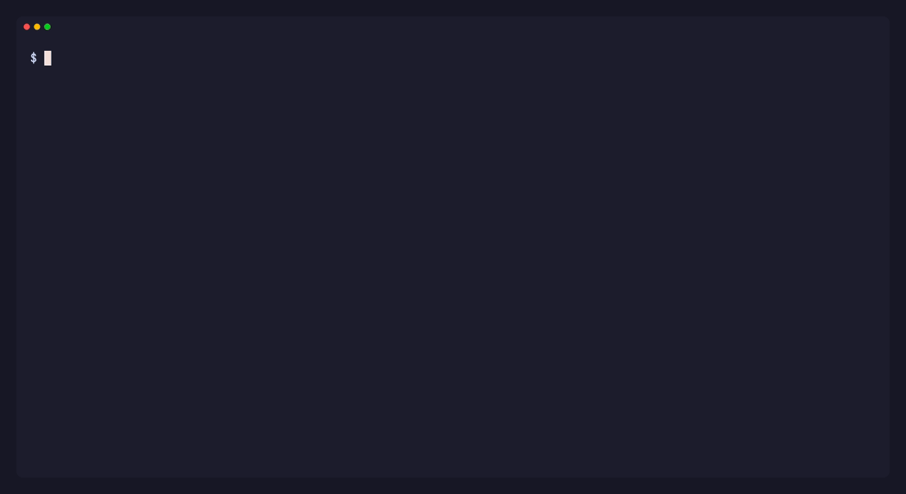

# Paramify Fetchers

[](https://github.com/paramify/paramify-fetchers/actions/workflows/ci.yml)
[](https://github.com/paramify/paramify-fetchers/releases)
[](pyproject.toml)
[](LICENSE)

Automate the evidence behind your compliance program. Paramify Fetchers read the configuration and activity of the tools you already run, such as AWS, Azure, GCP, Okta and Wiz. They turn that data into evidence for [FedRAMP 20x Key Security Indicators](docs/ksi_mapping.md) and NIST 800-53 controls, ready to upload to Paramify.

Each fetcher is a small, read-only script that writes JSON to disk. A separate uploader sends that evidence to Paramify, so nothing leaves your environment until you choose to upload. This repo contains the fetchers, the runner that executes them, and the uploader.

<a href="https://deepwiki.com/paramify/paramify-fetchers"></a>

**Have a question about this repo?** DeepWiki answers in plain English and links to the code that it read.

<div align="center">

<picture><source media="(prefers-color-scheme: dark)" srcset="docs/img/readme/how-it-works-dark.svg"></picture>

</div>

---

## Supported services

<div align="center">

<table>
  <tr>
    <td align="center" width="128"><a href="fetchers/aws/"><picture><source media="(prefers-color-scheme: dark)" srcset="fetchers/logos/aws-dark.svg"></picture></a><br><sub>AWS</sub></td>
    <td align="center" width="128"><a href="fetchers/azure/"></a><br><sub>Azure</sub></td>
    <td align="center" width="128"><a href="fetchers/gcp/"></a><br><sub>Google Cloud</sub></td>
    <td align="center" width="128"><a href="fetchers/wiz/"></a><br><sub>Wiz</sub></td>
    <td align="center" width="128"><a href="fetchers/datadog/"></a><br><sub>Datadog</sub></td>
    <td align="center" width="128"><a href="fetchers/okta/"><picture><source media="(prefers-color-scheme: dark)" srcset="fetchers/logos/okta-dark.svg"></picture></a><br><sub>Okta</sub></td>
  </tr>
  <tr>
    <td align="center" width="128"><a href="fetchers/crowdstrike/"></a><br><sub>CrowdStrike</sub></td>
    <td align="center" width="128"><a href="fetchers/splunk/"></a><br><sub>Splunk</sub></td>
    <td align="center" width="128"><a href="fetchers/sentinelone/"></a><br><sub>SentinelOne</sub></td>
    <td align="center" width="128"><a href="fetchers/knowbe4/"></a><br><sub>KnowBe4</sub></td>
    <td align="center" width="128"><a href="fetchers/gitlab/"></a><br><sub>GitLab</sub></td>
    <td align="center" width="128"><a href="fetchers/k8s/"></a><br><sub>Kubernetes</sub></td>
  </tr>
  <tr>
    <td align="center" width="128"><a href="fetchers/rippling/"><picture><source media="(prefers-color-scheme: dark)" srcset="fetchers/logos/rippling-dark.svg"></picture></a><br><sub>Rippling</sub></td>
    <td align="center" width="128"><a href="fetchers/paramify/"></a><br><sub>Paramify</sub></td>
    <td align="center" width="128"><a href="fetchers/checkov/"></a><br><sub>Checkov</sub></td>
    <td align="center" width="128"><a href="fetchers/servicenow/"></a><br><sub>ServiceNow</sub></td>
    <td align="center" width="128"><a href="fetchers/betterstack/"><picture><source media="(prefers-color-scheme: dark)" srcset="fetchers/logos/betterstack-dark.svg"></picture></a><br><sub>Better Stack</sub></td>
    <td align="center" width="128"><a href="fetchers/jira/"></a><br><sub>Jira</sub></td>
  </tr>
  <tr>
    <td align="center" width="128"><a href="fetchers/web/"><picture><source media="(prefers-color-scheme: dark)" srcset="fetchers/logos/web-dark.svg"></picture></a><br><sub>Web</sub></td>
    <td align="center" width="128"><a href="fetchers/zendesk/"><picture><source media="(prefers-color-scheme: dark)" srcset="fetchers/logos/zendesk-dark.svg"></picture></a><br><sub>Zendesk</sub></td>
  </tr>
</table>

</div>

<!-- BEGIN:fetcher-chart -->
<div align="center">

<picture><source media="(prefers-color-scheme: dark)" srcset="docs/coverage-over-time-dark.svg"></picture>

</div>

`python tools/generate_chart.py` draws this chart from the git history of this repo. CI draws it again each time a fetcher merges.
<!-- END:fetcher-chart -->

### Coming soon

More integrations are in progress. To ask for a new platform or fetcher, post in [Fetcher requests](https://github.com/paramify/paramify-fetchers/discussions/categories/fetcher-requests) in Discussions. Upvote the requests that you want built next.

<div align="center">

<table>
  <tr>
    <td align="center" width="128"><br><sub>SSL Labs</sub></td>
    <td align="center" width="128"><picture><source media="(prefers-color-scheme: dark)" srcset="fetchers/logos/github-dark.svg"></picture><br><sub>GitHub</sub></td>
    <td align="center" width="128"><picture><source media="(prefers-color-scheme: dark)" srcset="fetchers/logos/tenable-dark.svg"></picture><br><sub>Tenable</sub></td>
  </tr>
</table>

<sub>and more</sub>

</div>

---

## Try it in a minute

You do not need credentials. The bundled `demo_hello` fetcher writes synthetic evidence, so you can watch a full run before you connect a real service.

```bash
git clone https://github.com/paramify/paramify-fetchers.git && cd paramify-fetchers
python -m venv .venv && source .venv/bin/activate
pip install -e .
paramify run examples/demo.yaml                    # synthetic evidence, no credentials
paramify evidence evidence/run-*/demo_hello.json   # read what it wrote
```



---

## Install

**Prerequisites:** Python 3.10 or later.

```bash
git clone https://github.com/paramify/paramify-fetchers.git
cd paramify-fetchers
python -m venv .venv && source .venv/bin/activate
pip install -e '.[all]'      # '[all]' bundles the TUI; use `pip install -e .` for the headless CLI only
```

Each platform has its own requirements:

- Most fetchers call a CLI, such as `aws`, `jq`, `curl` or `kubectl`. Install only the CLIs for the platforms that you use.
- Azure and GCP use the official SDKs, not a CLI. Install them with `pip install -e '.[azure]'` or `pip install -e '.[gcp]'`. These extras are large, so `[all]` does not include them. Azure signs in with `DefaultAzureCredential` and GCP with Application Default Credentials, so neither one needs a key file.
- Most platforms have a credential setup guide at `fetchers/<category>/README.md`. Select a logo under [Supported services](#supported-services) to open its folder.

---

## Use it

You can use the fetchers in three ways. All three go through one facade (`framework.api`), so they behave the same.

### The TUI

`paramify tui` browses the catalog, builds and validates a manifest, runs it, and shows the evidence. You never leave the keyboard.


### Drive it with an AI agent

Every command takes `--json`, and each `paramify manifest` edit returns a stable `{ok, path, errors}` object. Thus an agent can build a runnable manifest without scraping the screen. The repo also ships Claude Code skills in [`.claude/skills/`](.claude/skills/). They scaffold a fetcher, onboard a new platform, wire a fetcher into a manifest, and propose validators.

### Using the CLI

The CLI does the same operations by hand:

```bash
paramify catalog                 # browse the fetchers
paramify describe <fetcher>      # see what one fetcher needs
paramify manifest init           # start a manifest, then add fetchers and secrets
paramify run manifest.yaml       # collect evidence
paramify upload                  # send the latest run to Paramify
```

[`docs/cli_guide.md`](docs/cli_guide.md) is the full CLI reference and has a complete walk-through. [`examples/`](examples/) has sample manifests, and [`deploy/README.md`](deploy/README.md) shows how to run on a schedule in a container.

---

## Contributing

To ask for a new platform or fetcher, post in [Fetcher requests](https://github.com/paramify/paramify-fetchers/discussions/categories/fetcher-requests). To add a fetcher yourself, start with [`CONTRIBUTING.md`](CONTRIBUTING.md). It gives the dev setup, the checks that CI runs, the ground rules, and the guides for each kind of fetcher.

---

## Where to read next

- **Set up a platform:** most platforms have a guide for their credentials and
  permissions. Select a logo under [Supported services](#supported-services) to
  open its folder.
- **Run fetchers:** [`docs/cli_guide.md`](docs/cli_guide.md) is the full CLI
  reference. [`docs/run_manifest_guide.md`](docs/run_manifest_guide.md) builds a
  manifest step by step.
- **Send results to Paramify:** [`docs/uploader_guide.md`](docs/uploader_guide.md)
  for evidence, and [`docs/pipelines_guide.md`](docs/pipelines_guide.md) for scan
  reports.
- **Write a fetcher:** [`docs/authoring_fetcher_guide.md`](docs/authoring_fetcher_guide.md).
- **How it works:** [`docs/architecture.md`](docs/architecture.md) explains the four parts, the evidence envelope and the repo layout.
- **FedRAMP KSI coverage:** [`docs/ksi_mapping.md`](docs/ksi_mapping.md).

The [documentation index](docs/README.md) lists every other guide and design
document.

## License

This project uses the GNU General Public License v3.0. See [`LICENSE`](LICENSE).
