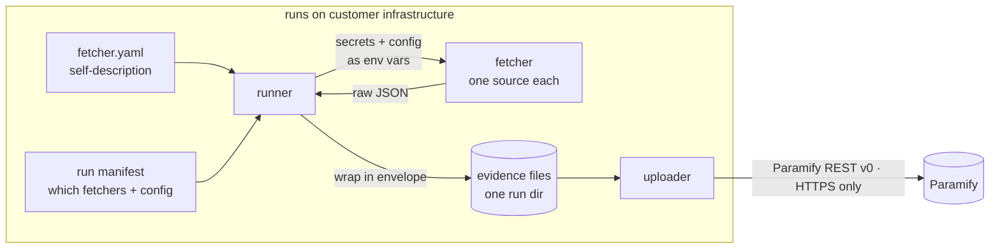

# Paramify Fetchers

[](https://github.com/paramify/paramify-fetchers/actions/workflows/ci.yml)
[](https://github.com/paramify/paramify-fetchers/releases)
[](pyproject.toml)
[](LICENSE)

Automate the evidence behind your compliance program. Paramify Fetchers read the configuration and activity of the tools you already run, such as AWS, Azure, GCP, Okta and Wiz. They turn that data into evidence for [FedRAMP 20x Key Security Indicators](docs/ksi_mapping.md) and NIST 800-53 controls, ready to upload to Paramify.

Each fetcher is a small, read-only script that writes JSON to disk. A separate uploader sends that evidence to Paramify, so nothing leaves your environment until you choose to upload. This repo contains the fetchers, the runner that executes them, and the uploader.

<a href="https://deepwiki.com/paramify/paramify-fetchers"></a>

**Have a question about this repo?** DeepWiki answers in plain English and links to the code that it read.

<div align="center">

<picture><source media="(prefers-color-scheme: dark)" srcset="docs/img/readme/how-it-works-dark.svg"></picture>

</div>

---

## Supported services

<div align="center">

<table>
  <tr>
    <td align="center" width="128"><a href="fetchers/aws/"><picture><source media="(prefers-color-scheme: dark)" srcset="fetchers/logos/aws-dark.svg"></picture></a><br><sub>AWS</sub></td>
    <td align="center" width="128"><a href="fetchers/azure/"></a><br><sub>Azure</sub></td>
    <td align="center" width="128"><a href="fetchers/gcp/"></a><br><sub>Google Cloud</sub></td>
    <td align="center" width="128"><a href="fetchers/wiz/"></a><br><sub>Wiz</sub></td>
    <td align="center" width="128"><a href="fetchers/datadog/"></a><br><sub>Datadog</sub></td>
    <td align="center" width="128"><a href="fetchers/okta/"><picture><source media="(prefers-color-scheme: dark)" srcset="fetchers/logos/okta-dark.svg"></picture></a><br><sub>Okta</sub></td>
  </tr>
  <tr>
    <td align="center" width="128"><a href="fetchers/crowdstrike/"></a><br><sub>CrowdStrike</sub></td>
    <td align="center" width="128"><a href="fetchers/splunk/"></a><br><sub>Splunk</sub></td>
    <td align="center" width="128"><a href="fetchers/sentinelone/"></a><br><sub>SentinelOne</sub></td>
    <td align="center" width="128"><a href="fetchers/knowbe4/"></a><br><sub>KnowBe4</sub></td>
    <td align="center" width="128"><a href="fetchers/gitlab/"></a><br><sub>GitLab</sub></td>
    <td align="center" width="128"><a href="fetchers/k8s/"></a><br><sub>Kubernetes</sub></td>
  </tr>
  <tr>
    <td align="center" width="128"><a href="fetchers/rippling/"><picture><source media="(prefers-color-scheme: dark)" srcset="fetchers/logos/rippling-dark.svg"></picture></a><br><sub>Rippling</sub></td>
    <td align="center" width="128"><a href="fetchers/paramify/"></a><br><sub>Paramify</sub></td>
    <td align="center" width="128"><a href="fetchers/checkov/"></a><br><sub>Checkov</sub></td>
    <td align="center" width="128"><a href="fetchers/servicenow/"></a><br><sub>ServiceNow</sub></td>
    <td align="center" width="128"><a href="fetchers/betterstack/"><picture><source media="(prefers-color-scheme: dark)" srcset="fetchers/logos/betterstack-dark.svg"></picture></a><br><sub>Better Stack</sub></td>
    <td align="center" width="128"><a href="fetchers/jira/"></a><br><sub>Jira</sub></td>
  </tr>
</table>

</div>

<!-- BEGIN:fetcher-chart -->
<div align="center">

<picture><source media="(prefers-color-scheme: dark)" srcset="docs/coverage-over-time-dark.svg"></picture>

</div>

`python tools/generate_chart.py` draws this chart from the git history of this repo. CI draws it again each time a fetcher merges.
<!-- END:fetcher-chart -->

### Coming soon

More integrations are in progress. To ask for a new platform or fetcher, post in [Fetcher requests](https://github.com/paramify/paramify-fetchers/discussions/categories/fetcher-requests) in Discussions. Upvote the requests that you want built next.

<div align="center">

<table>
  <tr>
    <td align="center" width="128"><br><sub>SSL Labs</sub></td>
    <td align="center" width="128"><picture><source media="(prefers-color-scheme: dark)" srcset="fetchers/logos/github-dark.svg"></picture><br><sub>GitHub</sub></td>
    <td align="center" width="128"><picture><source media="(prefers-color-scheme: dark)" srcset="fetchers/logos/tenable-dark.svg"></picture><br><sub>Tenable</sub></td>
  </tr>
</table>

<sub>and more</sub>

</div>

---

## Try it in a minute

You do not need credentials. The bundled `demo_hello` fetcher writes synthetic evidence, so you can watch a full run before you connect a real service.

```bash
git clone https://github.com/paramify/paramify-fetchers.git && cd paramify-fetchers
python -m venv .venv && source .venv/bin/activate
pip install -e .
paramify run examples/demo.yaml                    # synthetic evidence, no credentials
paramify evidence evidence/run-*/demo_hello.json   # read what it wrote
```

For real services, [Install](#install) lists the extras and CLIs that each one needs. Then pick how you want to use it: the [TUI](#the-tui), an [AI agent](#drive-it-with-an-ai-agent), or the [CLI](#using-the-cli).

---

## Install

**Prerequisites:** Python 3.10 or later. The CLIs that your fetchers use (`aws`, `jq`, `curl`, `kubectl` and others) must be on your `PATH`. Install only the CLIs for the categories that you run. Most services have a credential setup guide at `fetchers/<category>/README.md`. The [documentation index](docs/README.md#run-fetchers) lists them.

```bash
git clone https://github.com/paramify/paramify-fetchers.git
cd paramify-fetchers
python -m venv .venv && source .venv/bin/activate
pip install -e '.[all]'      # '[all]' bundles the TUI; use `pip install -e .` for the headless CLI only
```

Azure and GCP do not use a CLI. They talk to their cloud through the official SDKs, so each one has its own extra. Neither one needs a cloud CLI at runtime.

```bash
pip install -e '.[azure]'    # 32 packages; no `az` CLI at runtime
pip install -e '.[gcp]'      # 12 packages; no `gcloud` at runtime
```

These two extras are not in `[all]` on purpose. They are the heaviest extras, and you need them only if you run those categories. Azure signs in through `DefaultAzureCredential`, and GCP through Application Default Credentials. Neither one uses a static key file.

You can use the fetchers in three ways: an interactive **TUI**, an **AI agent**, or the **CLI**. All three go through one facade (`framework.api`), so they behave the same. Pick the one that fits how you work.

---

## The TUI

The TUI is the fastest way to start. `paramify tui` browses the catalog, builds and validates a manifest, runs it, and shows the evidence. You never leave the keyboard.


**Scan reports** (Nessus, Wiz, STIG results and similar files) go into Paramify pipelines, which need a short setup. You write a manifest for the scanners and give each one an assessment and a close policy. Then you send the reports from the Paramify tab. [`docs/pipelines_guide.md`](docs/pipelines_guide.md) walks through it, with recordings.

The recordings on this page used a larger set of synthetic fetchers than the repo ships. Thus your own run is shorter than the one in the recording: `examples/demo.yaml` collects once and exits clean. The runner, the envelope and the command output in the recordings are the same as what you get.


---

## Drive it with an AI agent

Every command takes `--json`. Each `paramify manifest` edit returns a stable `{ok, path, errors}` object. An agent reads `errors` and fixes each gap until the manifest can run. It does not need to scrape the screen.

```bash
paramify catalog --json                                  # discover what's available
paramify manifest add okta_phishing_resistant_mfa --json # → {"ok": false, "errors": [ …missing secrets… ]}
paramify manifest set-secret okta_phishing_resistant_mfa api_token OKTA_API_TOKEN --json
# …repeat until:
paramify validate manifest.yaml --json                   # → {"ok": true, "errors": []}
```

The repo also ships four Claude Code skills in [`.claude/skills/`](.claude/skills/):

- `create-fetcher` scaffolds a new fetcher.
- `onboard-platform` onboards a platform that has no fetchers yet.
- `wire-manifest` adds a fetcher to a manifest and fills in what it needs.
- `suggest-validator` proposes a validator.

---

## Using the CLI

The CLI does the same operations by hand. `paramify catalog` lists the catalog, and `paramify describe <fetcher>` shows what one fetcher needs:


A typical run, step by step:

```bash
# 1. Browse available fetchers by category
paramify catalog

# 2. Start a manifest and wire in your fetchers
paramify manifest init
paramify manifest add okta_phishing_resistant_mfa
paramify manifest set-secret okta_phishing_resistant_mfa api_token OKTA_API_TOKEN
paramify manifest set-secret okta_phishing_resistant_mfa org_url OKTA_ORG_URL
# The manifest builder reports missing secrets after each step.
# Keep going until it says the manifest is runnable.

# 3. Set your credentials and run
export OKTA_API_TOKEN=<your token>
export OKTA_ORG_URL=https://your-org.okta.com
paramify validate manifest.yaml
paramify run     manifest.yaml         # evidence → ./evidence/run-<timestamp>/

# 4. Upload to Paramify
export PARAMIFY_UPLOAD_API_TOKEN=<your token>   # see uploaders/paramify_evidence/README.md for setup
paramify upload                                  # push the latest run
```

Most services have a credential setup guide in their fetcher directory. For example, [`fetchers/okta/README.md`](fetchers/okta/README.md) shows how to create an Okta API token and which admin role it needs. [`examples/`](examples/) has full sample manifests, such as multi-region AWS and GitLab fanout. [`deploy/README.md`](deploy/README.md) shows how to run on a schedule in Docker.

[`docs/cli_guide.md`](docs/cli_guide.md) is the full CLI reference. It covers every
command, manifest building, the `paramify doctor` preflight, uploads, scan reports,
inventory, discovery and script sync.

---

## How it runs

The framework has four parts, and each one has its own job:

- **Fetcher:** a small script (`fetcher.py` or `fetcher.sh`) that collects from *one* source and writes a JSON file. It reads all its inputs from environment variables and writes only to `EVIDENCE_DIR`.
- **`fetcher.yaml`:** the description of the fetcher. It gives the name, the secrets and config that the fetcher needs, the output, and the `evidence_set` identity. It ships with the code, and a schema validates it. Customers never edit this file.
- **Run manifest:** what the customer wants to run. It lists the fetchers, their config, and their targets. It lives in the customer's environment, not in this repo.
- **Runner:** reads the `fetcher.yaml` files and a manifest, turns secrets and config into environment variables, and runs each fetcher.



Discovery, manifest edits, validation and runs all go through one facade, `framework.api`. The TUI, the CLI and the `--json` output for agents use that one code path. As a result, they behave the same.

Output goes to `<output_dir>/run-<UTC-timestamp>/`. Each fetcher writes one JSON file, or one per target for fan-out. A `_run_metadata.json` file indexes the run, and the runner does not envelope this index. The runner wraps each evidence file in an envelope: `{schema_version, metadata, payload}`.

The `metadata` block holds:

- the fetcher name, version and category
- the run id, the target and `collected_at`
- the status and the exit code
- the `evidence_set` identity
- a `stderr_tail`, but only for a failed run

Here is a finished evidence file from an AWS VPC segmentation run, shortened:

```json
{
  "schema_version": "1.0",
  "metadata": {
    "fetcher_name": "aws_vpc_network_segmentation",
    "fetcher_version": "0.1.0",
    "category": "aws",
    "run_id": "2026-06-16T15-56-41Z",
    "target": { "region": "us-east-1" },
    "collected_at": "2026-06-16T16:00:14Z",
    "status": "success",
    "exit_code": 0,
    "evidence_set": {
      "reference_id": "EVD-VPC-SEGMENTATION",
      "name": "VPC Network Segmentation",
      "instructions": "Script: fetcher.sh. Commands: aws ec2 describe-vpcs, describe-subnets, describe-vpc-peering-connections, describe-vpc-endpoints.",
      "description": "Lists VPCs, subnets, peering connections, and endpoints to document network topology and segmentation."
    }
  },
  "payload": {
    "metadata": { "account_id": "111122223333", "region": "us-east-1", "datetime": "2026-06-16T16:00:14Z" },
    "results": [
      { "ResourceType": "Vpcs", "Items": [
        { "VpcId": "vpc-0a1b2c3d", "CidrBlock": "172.31.0.0/16", "IsDefault": true, "State": "available" }
      ] },
      { "ResourceType": "Subnets", "Items": [
        { "SubnetId": "subnet-0d7e6de0", "VpcId": "vpc-0a1b2c3d", "CidrBlock": "172.31.80.0/20", "AvailabilityZone": "us-east-1b" }
      ] }
    ]
  }
}
```

The runner owns the `metadata` envelope, and the fetcher owns `payload`. The `evidence_set` block comes from `fetcher.yaml`. It tells Paramify which evidence set the uploaded file belongs to. The file has no pass or fail verdict. Paramify makes that judgment, by design. (The example leaves out the peering connections and endpoints to save space.)

> **Status:** pre-1.0 (v0.x). The runner wraps every output in the
> `metadata`+`payload` envelope. But fetchers still write raw evidence dicts and
> read the environment directly. They do not get a typed secrets object yet.
> These are known interim shortcuts, not the target design. Comparators
> (`depends_on`) are not built yet. Structured exit-code categories are not built
> either: exit codes are still binary `0`/`1`, plus `124` when the runner kills a
> fetcher on timeout. Issue-report collection is complete: the contract, the
> runner, the uploader and the template. Wiz ships the first three vendor fetchers
> of that kind.

---

## Repository layout

```
framework/                      # shared code (facade, runner, contract, schemas)
  api.py                        # the facade: discovery, manifest edit, validate, run
  schemas/                      # fetcher / manifest / category JSON Schemas
  cli.py                        # the `paramify` CLI: one command, steers every front-end
  runner/                       # executor + manifest loader (+ `python -m framework.runner` shim)
  tui/                          # terminal UI front-end (Textual)
fetchers/
  _categories/<name>.yaml       # platform-wide config + auth for a category
  _template/                    # copy this to start a new fetcher
  _template_issue_report/       # …or this, for a raw scan-report fetcher
  _template_inventory/          # …or this, for an asset-inventory fetcher
  <category>/
    README.md                   # credential setup guide for this service
    _shared/                    # code shared across fetchers in this category
    <short_name>/               # one directory per fetcher
      fetcher.yaml
      fetcher.py | fetcher.sh
comparators/                    # cross-source comparators (template only so far)
uploaders/
  paramify_evidence/            # push evidence to Paramify (built)
  paramify_issues/              # send raw scan reports into assessment pipelines (built)
  paramify_scripts/             # push fetcher entry scripts + associate to evidence sets (built)
examples/                       # sample run manifests
tests/                          # framework test suite (pytest)
example_manifest.yaml           # worked reference manifest
run_and_upload.sh               # example collect→upload glue
docs/                           # contract, design, and reference guides
```

Directories that start with `_` are not fetchers, and the runner skips them.

---

## Adding a fetcher

- To collect evidence for a new control or a new tool, read [`docs/authoring_a_fetcher.md`](docs/authoring_a_fetcher.md).
- If a platform has no fetchers yet and you want a full set, start from [`docs/platform_onboarding_guide.md`](docs/platform_onboarding_guide.md).
- Some tools already produce findings, for example a vulnerability scan or a CSPM export. For these tools, write an issue-report fetcher: [`docs/issue_report_fetchers.md`](docs/issue_report_fetchers.md).

Before you open a pull request, read [`CONTRIBUTING.md`](CONTRIBUTING.md). It gives the dev setup, the checks that CI runs, and the ground rules.

---

## Where to read next

- **Set up a platform:** most platforms have a guide for their credentials and
  permissions. Select a logo under [Supported services](#supported-services) to
  open its folder.
- **Run fetchers:** [`docs/cli_guide.md`](docs/cli_guide.md) is the full CLI
  reference. [`docs/run_manifest_guide.md`](docs/run_manifest_guide.md) builds a
  manifest step by step.
- **Send results to Paramify:** [`docs/uploader_guide.md`](docs/uploader_guide.md)
  for evidence, and [`docs/pipelines_guide.md`](docs/pipelines_guide.md) for scan
  reports.
- **Write a fetcher:** [`docs/authoring_fetcher_guide.md`](docs/authoring_fetcher_guide.md).
- **FedRAMP KSI coverage:** [`docs/ksi_mapping.md`](docs/ksi_mapping.md).

The [documentation index](docs/README.md) lists every other guide and design
document.

## License

This project uses the GNU General Public License v3.0. See [`LICENSE`](LICENSE).
