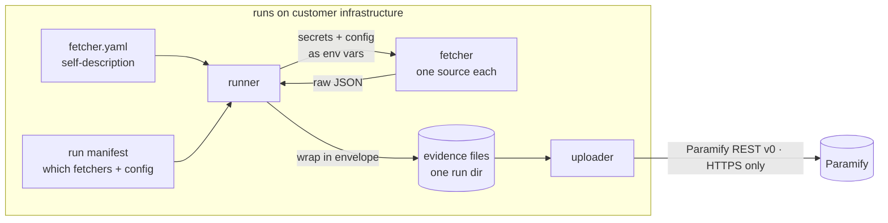

# How it runs

This page explains the parts of the framework, the evidence that a run writes,
and where each part lives in the repo. To follow one run step by step, read
[`architecture_guide.md`](architecture_guide.md).

## The four parts

The framework has four parts, and each one has its own job:

- **Fetcher:** a small script (`fetcher.py` or `fetcher.sh`) that collects from *one* source and writes a JSON file. It reads all its inputs from environment variables and writes only to `EVIDENCE_DIR`.
- **`fetcher.yaml`:** the description of the fetcher. It gives the name, the secrets and config that the fetcher needs, the output, and the `evidence_set` identity. It ships with the code, and a schema validates it. Customers never edit this file.
- **Run manifest:** what the customer wants to run. It lists the fetchers, their config, and their targets. It lives in the customer's environment, not in this repo.
- **Runner:** reads the `fetcher.yaml` files and a manifest, turns secrets and config into environment variables, and runs each fetcher.



Discovery, manifest edits, validation and runs all go through one facade, `framework.api`. The TUI, the CLI and the `--json` output for agents use that one code path. As a result, they behave the same.

Output goes to `<output_dir>/run-<UTC-timestamp>/`. Each fetcher writes one JSON file, or one per target for fan-out. A `_run_metadata.json` file indexes the run, and the runner does not envelope this index. The runner wraps each evidence file in an envelope: `{schema_version, metadata, payload}`.

The `metadata` block holds:

- the fetcher name, version and category
- the run id, the target and `collected_at`
- the status and the exit code
- the `evidence_set` identity
- a `stderr_tail`, but only for a failed run

Here is a finished evidence file from an AWS VPC segmentation run, shortened:

```json
{
  "schema_version": "1.0",
  "metadata": {
    "fetcher_name": "aws_vpc_network_segmentation",
    "fetcher_version": "0.1.0",
    "category": "aws",
    "run_id": "2026-06-16T15-56-41Z",
    "target": { "region": "us-east-1" },
    "collected_at": "2026-06-16T16:00:14Z",
    "status": "success",
    "exit_code": 0,
    "evidence_set": {
      "reference_id": "EVD-VPC-SEGMENTATION",
      "name": "VPC Network Segmentation",
      "instructions": "Script: fetcher.sh. Commands: aws ec2 describe-vpcs, describe-subnets, describe-vpc-peering-connections, describe-vpc-endpoints.",
      "description": "Lists VPCs, subnets, peering connections, and endpoints to document network topology and segmentation."
    }
  },
  "payload": {
    "metadata": { "account_id": "111122223333", "region": "us-east-1", "datetime": "2026-06-16T16:00:14Z" },
    "results": [
      { "ResourceType": "Vpcs", "Items": [
        { "VpcId": "vpc-0a1b2c3d", "CidrBlock": "172.31.0.0/16", "IsDefault": true, "State": "available" }
      ] },
      { "ResourceType": "Subnets", "Items": [
        { "SubnetId": "subnet-0d7e6de0", "VpcId": "vpc-0a1b2c3d", "CidrBlock": "172.31.80.0/20", "AvailabilityZone": "us-east-1b" }
      ] }
    ]
  }
}
```

The runner owns the `metadata` envelope, and the fetcher owns `payload`. The `evidence_set` block comes from `fetcher.yaml`. It tells Paramify which evidence set the uploaded file belongs to. The file has no pass or fail verdict. Paramify makes that judgment, by design. (The example leaves out the peering connections and endpoints to save space.)

> **Status:** pre-1.0 (v0.x). The runner wraps every output in the
> `metadata`+`payload` envelope. But fetchers still write raw evidence dicts and
> read the environment directly. They do not get a typed secrets object yet.
> These are known interim shortcuts, not the target design. Comparators
> (`depends_on`) are built, with one demo so far ([`comparators.md`](comparators.md)).
> Structured exit-code categories are not built
> either: exit codes are still binary `0`/`1`, plus `124` when the runner kills a
> fetcher on timeout. Issue-report collection is complete: the contract, the
> runner, the uploader and the template. Wiz ships the first three vendor fetchers
> of that kind.

## Repository layout

```
framework/                      # shared code (facade, runner, contract, schemas)
  api.py                        # the facade: discovery, manifest edit, validate, run
  schemas/                      # fetcher / manifest / category JSON Schemas
  cli.py                        # the `paramify` CLI: one command, steers every front-end
  runner/                       # executor + manifest loader (+ `python -m framework.runner` shim)
  tui/                          # terminal UI front-end (Textual)
fetchers/
  _categories/<name>.yaml       # platform-wide config + auth for a category
  _template/                    # copy this to start a new fetcher
  _template_issue_report/       # …or this, for a raw scan-report fetcher
  _template_inventory/          # …or this, for an asset-inventory fetcher
  <category>/
    README.md                   # credential setup guide for this service
    _shared/                    # code shared across fetchers in this category
    <short_name>/               # one directory per fetcher
      fetcher.yaml
      fetcher.py | fetcher.sh
comparators/
  _lib/comparator_inputs.py     # the shared reader for a comparator's inputs
  _template/                    # copy this to start a comparator
  <category>/<short_name>/      # a comparator: fetcher.yaml with depends_on + fetcher.py
uploaders/
  paramify_evidence/            # push evidence to Paramify (built)
  paramify_issues/              # send raw scan reports into assessment pipelines (built)
  paramify_scripts/             # push fetcher entry scripts + associate to evidence sets (built)
examples/                       # sample run manifests
tests/                          # framework test suite (pytest)
example_manifest.yaml           # worked reference manifest
run_and_upload.sh               # example collect→upload glue
docs/                           # contract, design, and reference guides
```

Directories that start with `_` are not fetchers, and the runner skips them.
