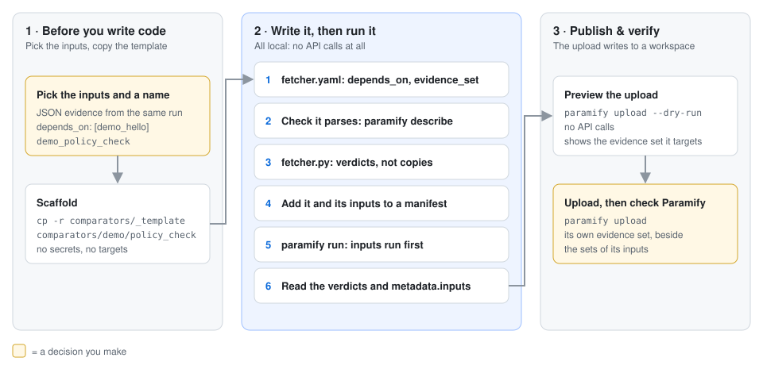
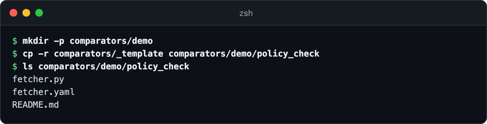
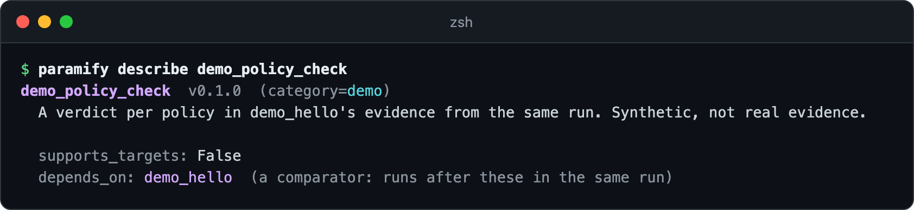
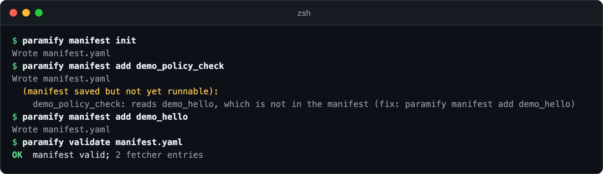
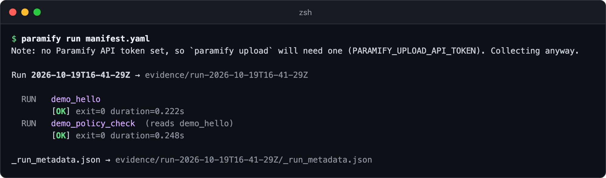
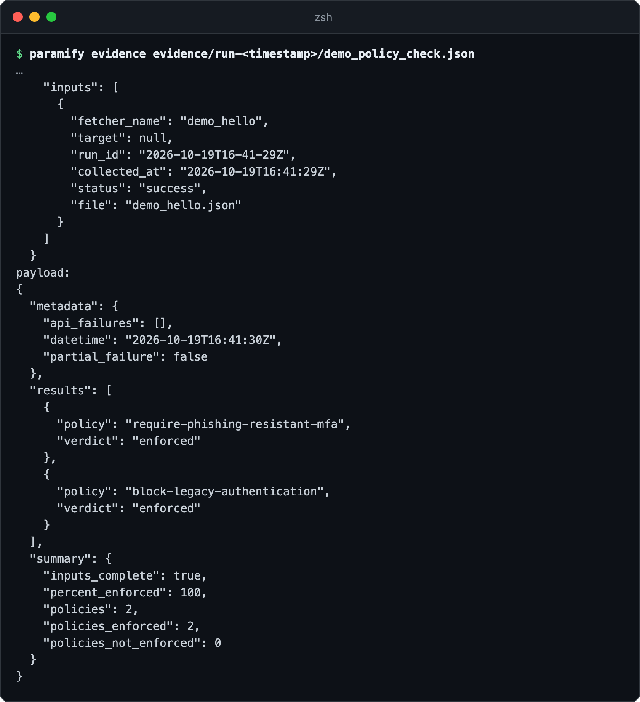
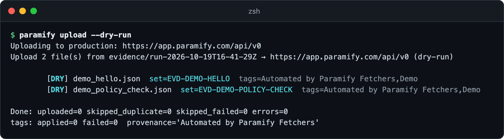

# Writing a comparator

A comparator reads other fetchers' evidence from the same run, matches records
across them, and writes one evidence file that a validator can check. This walks
through `demo_policy_check`, which ships with the repo and reads `demo_hello`.
You copy the template, name the inputs, write the comparison, then run it after
its inputs and preview the upload.



**You need:** [the repo installed](../README.md#install) · the fetchers whose
evidence you'll compare, each [writing JSON evidence](comparators.md#inputs)

---

## 1. Copy the template

Comparators live under `comparators/`, not `fetchers/`, so it's clear which code
calls an API ([why](comparators.md#where-comparators-live)).



<details><summary>Copy the commands</summary>

```bash
mkdir -p comparators/<category>
cp -r comparators/_template comparators/<category>/<short_name>
ls comparators/<category>/<short_name>
```
</details>

## 2. Name the inputs in `fetcher.yaml`

Replace every placeholder. `depends_on` is what makes it a comparator. Leave
`secrets` empty and add no targets: the runner gives a comparator no
credentials ([fetcher.yaml rules](comparators.md#fetcheryaml)).

```yaml
name: demo_policy_check
version: 0.1.0
description: A verdict per policy in demo_hello's evidence from the same run.
category: demo
depends_on:
  - demo_hello
runtime:
  type: python
  entry: fetcher.py
output:
  type: json
  path: demo_policy_check.json
secrets: []
evidence_set:
  reference_id: EVD-DEMO-POLICY-CHECK
  name: Demo — Synthetic Policy Check
```



<details><summary>Copy the command</summary>

```bash
paramify describe <category>_<short_name>
```
</details>

## 3. Write the comparison

`load_inputs()` reads each input's files in place, and `build_payload()` applies
the [input policy](comparators.md#failed-partial-and-missing-inputs). Write
verdicts, not copies of the input records. The template's `main()` does the
rest:

```python
inputs = load_inputs()
results, summary, error = [], dict.fromkeys(SUMMARY_KEYS), None
if not inputs.missing:
    try:
        results, summary = check(inputs["demo_hello"].payloads)
    except Exception as exc:
        error = f"cannot check the input: {exc.__class__.__name__}: {exc}"
# writes build_payload(inputs, results, summary, error) to EVIDENCE_DIR, then:
if error:
    report_failure(error, "internal_error")
    return 1
if not inputs.complete:
    report_failure(inputs.reason(), "input_failed")
    return 1
```

## 4. Add it and its inputs to a manifest

`validate` names any input the manifest doesn't run, and the fix
([manifest commands](cli_guide.md#building-a-manifest)).



<details><summary>Copy the commands</summary>

```bash
paramify manifest init
paramify manifest add <category>_<short_name>
paramify manifest add <each input>
paramify validate manifest.yaml
```
</details>

## 5. Run it

The comparator was added first, but it runs after its input.



<details><summary>Copy the command</summary>

```bash
paramify run manifest.yaml
```
</details>

## 6. Read the verdicts

The runner adds `metadata.inputs`: each input file it handed over. Your payload
holds one verdict per record, and `summary` carries `inputs_complete`
([output](comparators.md#output)).



<details><summary>Copy the command</summary>

```bash
paramify evidence evidence/run-<timestamp>/<category>_<short_name>.json
```
</details>

## 7. Preview the upload

Each file goes to its own evidence set, so the comparator's verdicts sit beside
its inputs. Then [upload and check Paramify](uploader_guide.md#4-upload).



<details><summary>Copy the command</summary>

```bash
paramify upload --dry-run
```
</details>

**Next:** [write validators for it](suggest_validator_guide.md)

---

## Troubleshooting

| Symptom | Fix |
|---|---|
| Every `paramify` command fails with `depends_on names an unknown fetcher` | A copied template still lists `<input_fetcher_a>`. Name real fetchers in `depends_on`. |
| `declares depends_on, so it is a comparator and belongs under comparators/` | Move the directory to `comparators/<category>/<short_name>/`. |
| `which writes no JSON evidence` | An input is an issue report, a discovery fetcher, or writes CSV or HTML. Compare a JSON evidence fetcher instead. |
| The comparator shows `[FAIL]` with `input_failed` | Open the evidence of the input its `error` names; that file holds the cause. |
| Every summary value is `null` | An input is missing: not in the manifest, not run, or no complete file. `metadata.error` says which. |
| `COMPARATOR_INPUTS is not set` | You ran `fetcher.py` by hand. Run it with `paramify run`. |

**More detail:** [comparator reference](comparators.md) ·
[design and decisions](comparators_design.md) ·
[the create-fetcher skill](../.claude/skills/create-fetcher/SKILL.md)
