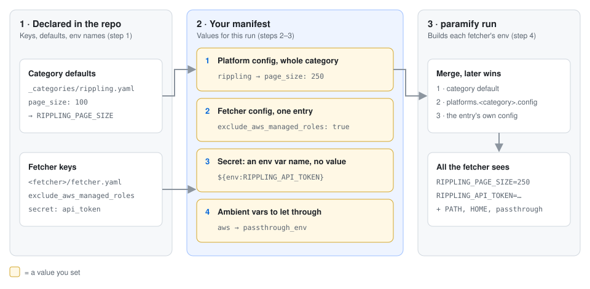
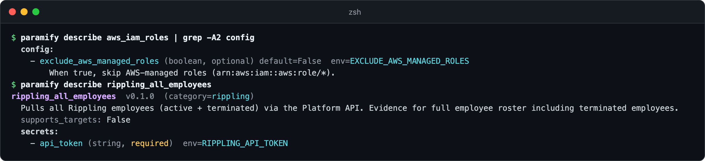
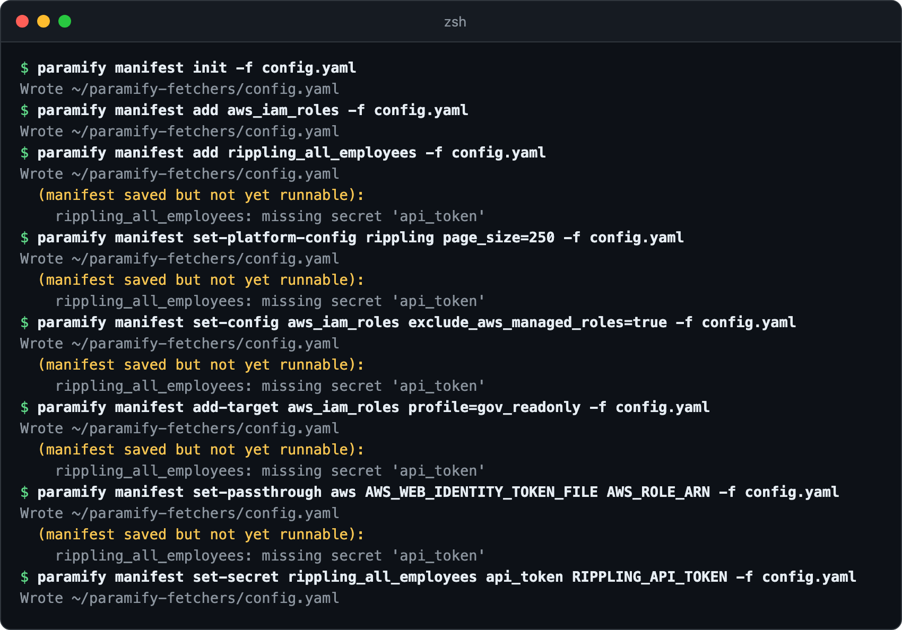
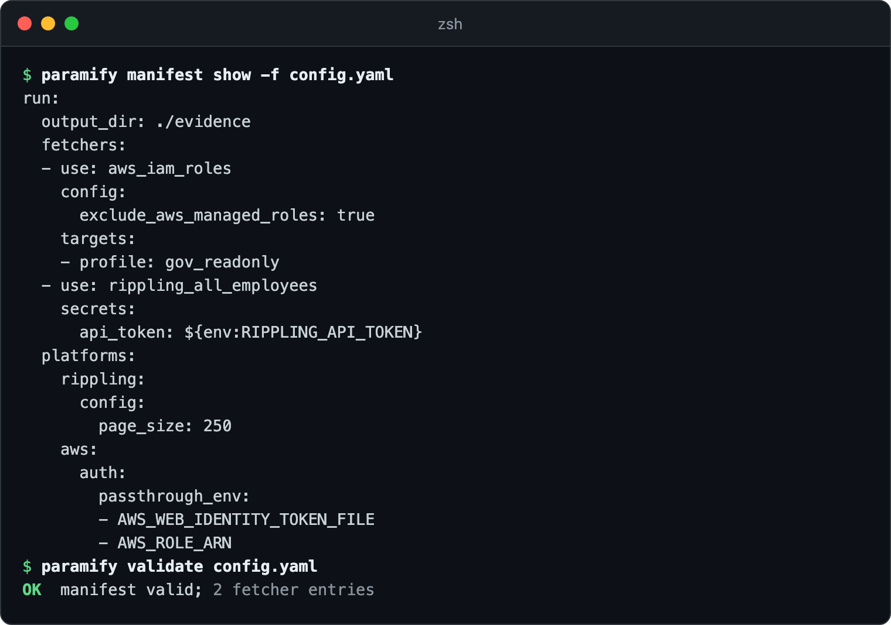
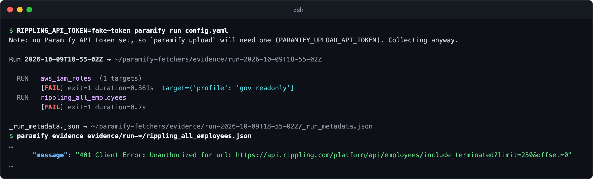
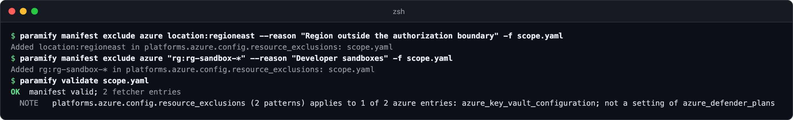

# Giving a fetcher its config and secrets

A fetcher doesn't inherit your shell's environment. The runner injects its
config and secrets from your manifest. This guide builds
[`examples/with_platform_config.yaml`](../examples/with_platform_config.yaml)
and runs it.



**You need:** [the repo installed](../README.md#install)

---

## 1. Look up the keys

`describe` lists a fetcher's config and secrets with their env vars. Platform
keys and defaults live in category files, like
[`rippling.yaml`](../fetchers/_categories/rippling.yaml).



<details><summary>Copy the commands</summary>

```bash
paramify describe aws_iam_roles | grep -A2 config
paramify describe rippling_all_employees
```
</details>

## 2. Set the values

Platform config covers a category. An entry's `config` overrides it.
`set-secret` stores an env var name, never the value. AWS already passes both
passthrough variables, so `set-passthrough` here only shows the syntax.



<details><summary>Copy the commands</summary>

```bash
paramify manifest init -f config.yaml
paramify manifest add aws_iam_roles -f config.yaml
paramify manifest add rippling_all_employees -f config.yaml
paramify manifest set-platform-config rippling page_size=250 -f config.yaml
paramify manifest set-config aws_iam_roles exclude_aws_managed_roles=true -f config.yaml
paramify manifest add-target aws_iam_roles profile=gov_readonly -f config.yaml
paramify manifest set-passthrough aws AWS_WEB_IDENTITY_TOKEN_FILE AWS_ROLE_ARN -f config.yaml
paramify manifest set-secret rippling_all_employees api_token RIPPLING_API_TOKEN -f config.yaml
```
</details>

**`validate` checks key names.** A key no fetcher takes fails it, with a
did-you-mean hint.

A string config field can also be `${env:VAR}`, read from the environment at
run time. If `VAR` is unset or empty, the next value down applies (platform
config, then the default), and the run prints a note. Integer and boolean
fields and target fields don't take `${env:VAR}` (a target's secrets do), and
`manifest` and `validate` refuse one there.

The reference must be the whole value: `qa.* ${env:VAR}` is refused. So is a
reference to a variable whose name looks like a credential's (it contains
`SECRET`, `TOKEN`, `PASSWORD`, `PASSWD`, `CREDENTIAL`, `PRIVATE_KEY` or
`CONNECTION_STRING`, or has a `KEY`, `KEYS`, `APIKEY`, `PAT`, `PASS`, `PWD` or
`SAS` part, such as `DATADOG_API_KEY`), and, by `validate` and the run, a
reference to any variable that holds a secret: one a fetcher or category in the
catalog declares, or one a `secrets:` reference anywhere in the manifest reads.
The run masks the value it reads out of the fetcher's logs and the run metadata,
but a fetcher may still write it into its evidence. A
[pattern list](#5-leave-resources-out-of-scope) takes no `${env:VAR}`, and the
runner never reads one from `.env` or the shell.

## 3. Check it

It matches the worked example.



<details><summary>Copy the commands</summary>

```bash
paramify manifest show -f config.yaml
paramify validate config.yaml
```
</details>

## 4. Run it

Both entries fail with a fake token, but Rippling's evidence shows
`limit=250`, not the default 100.



<details><summary>Copy the commands</summary>

```bash
RIPPLING_API_TOKEN=fake-token paramify run config.yaml
paramify evidence evidence/run-<timestamp>/rippling_all_employees.json
```
</details>

## 5. Leave resources out of scope

Some fields are pattern lists, such as Azure's `resource_exclusions`.
`manifest exclude` adds a pattern, with a reason if you give one, to the list
whose prefixes take it. A category list reaches every entry that declares the
field, and `validate` names them. An entry's own list replaces it.



<details><summary>Copy the commands</summary>

```bash
paramify manifest exclude azure location:regioneast --reason "Region outside the authorization boundary" -f scope.yaml
paramify manifest exclude azure "rg:rg-sandbox-*" --reason "Developer sandboxes" -f scope.yaml
paramify validate scope.yaml
```
</details>

Front Door and DNS `scope_exclusions` take different patterns, so set them on
each fetcher. The TUI edits an entry's lists too (`e`), one
`pattern  # reason` per line. Each evidence file records the patterns and
reasons its fetcher received in
[`metadata.config_patterns`](envelope_guide.md#2-read-its-envelope).
Full sample: [`azure_scope_exclusions.yaml`](../examples/azure_scope_exclusions.yaml).

---

## Troubleshooting

| Symptom | Fix |
|---|---|
| `Secret reference ${env:…} could not be resolved` | Export that variable in the shell that runs `paramify`. |
| `NOTE target selects AWS_PROFILE; ignored ambient credentials …` | Expected: a target's `profile:` overrides static AWS keys. Remove it to use them. |
| `has the unknown prefix …` or `needs one of the prefixes …` | That list doesn't take the pattern. `paramify describe <fetcher>` shows what each list takes. |
| `${env:} references aren't read for a pattern list` | Write the patterns in the manifest with `paramify manifest exclude`. |
| `a comparator ignores platforms.<category>.config` | A [comparator](comparators.md#how-the-runner-runs-one) gets none of its category's config, secrets or passthrough env. Set its own config on its entry with `paramify manifest set-config`. |

**More detail:** [shared platform config](run_manifest_guide.md#4-set-shared-config-once)
