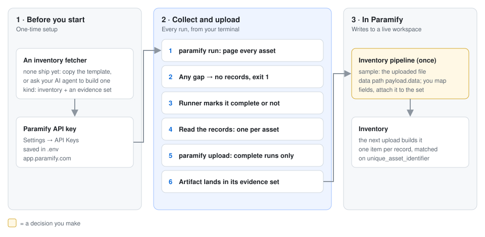
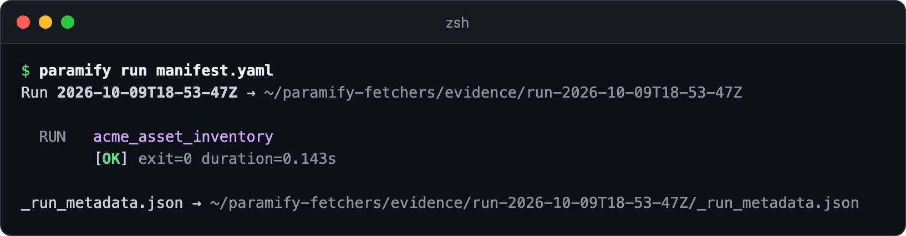
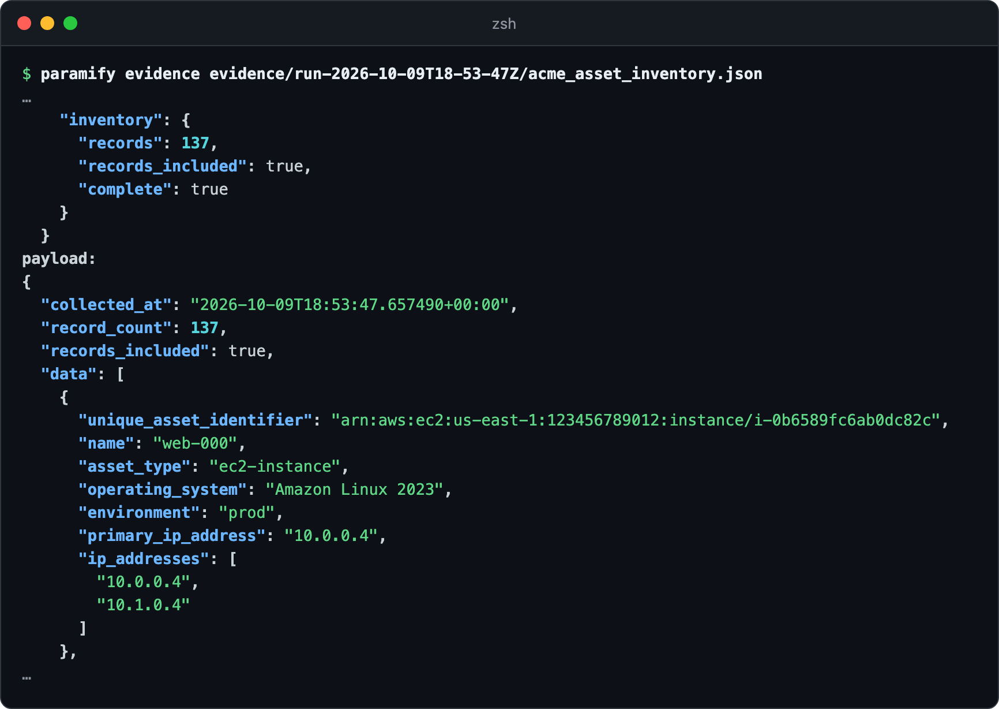
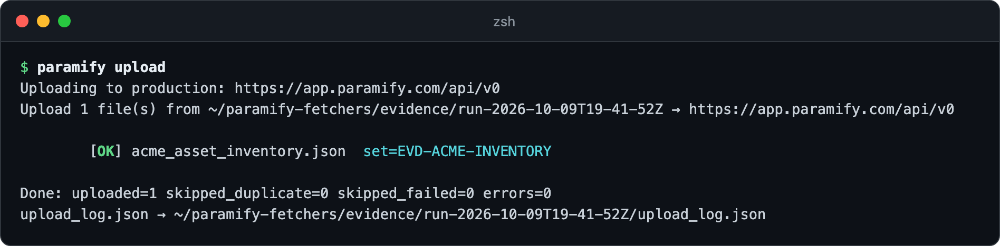
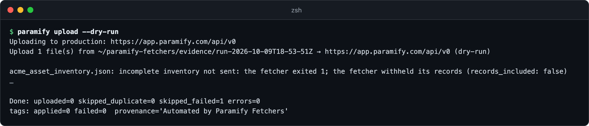

# Running an inventory fetcher

An inventory fetcher lists every asset of one kind, one record each. Upload
it, and a Paramify inventory pipeline turns each record into an Inventory item.



**You need:** [the repo installed](../README.md#install) ·
[an API key](../uploaders/paramify_evidence/README.md#paramify-api-key) ·
an inventory fetcher ([`aws_config_inventory`](../fetchers/aws/config_inventory/fetcher.yaml),
`github_repository_inventory`, `sophos_endpoint_inventory` and
[`wiz_inventory`](../fetchers/wiz/inventory/README.md) ship; to write another,
[copy the template](../fetchers/_template_inventory/), see the
[pipeline fetchers guide](pipeline_fetchers_guide.md), or ask
[your AI agent](../README.md#drive-it-with-an-ai-agent)). The example is
`acme_asset_inventory`.

For AWS Config, run once against an aggregator using the standard AWS CLI
credential chain. Both commercial AWS and GovCloud work; `region` selects the
aggregator endpoint, not a filter on the assets' regions:

```yaml
run:
  fetchers:
    - use: aws_config_inventory
      config:
        aggregator_name: organization-inventory
        profile: inventory-reader
        region: us-east-1 # For GovCloud, e.g. us-gov-west-1
        require_all_regions: true
        resource_types: '*' # Or AWS::EC2::Instance,AWS::RDS::DBInstance
```

The default includes every recorded resource type. Assets retain their source
ARNs, including the `aws` or `aws-us-gov` partition; resources without an ARN
use their partition/account/region/type/resource-ID tuple. Network details are
normalized for EC2 instances and interfaces, RDS instances, load balancers, and
WorkSpaces. Other types retain their identity, name, tags, and Config timestamp;
unknown inventory fields stay null. No organization-specific names or exclusions
apply. Use the AWS profile's `use_fips_endpoint` setting when required.

Config recording must already cover the intended accounts, regions, and resource
types. An all-regions aggregator cannot discover resources Config does not record.
Source status checks reject reported failures, but do not prove recording coverage
or instantaneous freshness: Config aggregation is eventually consistent. This
fetcher performs no second service scan and does not collect XLSX reports.

---

## 1. Run it

[Add it to a manifest](cli_guide.md#building-a-manifest), then run it.



<details><summary>Copy the command</summary>

```bash
paramify run manifest.yaml
```
</details>

## 2. Check the records

The runner's verdict must read `complete`: *true*. Each record under
`payload.data` has a stable, unique ID and an `asset_type`, such as `endpoint`.
Paramify takes each record's parent component from `asset_type`.



<details><summary>Copy the command</summary>

```bash
paramify evidence evidence/run-<timestamp>/acme_asset_inventory.json
```
</details>

## 3. Set up the pipeline (once)

Do this before your first upload. An inventory pipeline runs only on a file in
an approved batch, so the set must be ready first.

1. Run `paramify preset` for the fetcher. It prints what to enter: the sample
   file, the data path, the unique ID and the `asset_type` values of your last
   run.

   <details><summary>Copy the command</summary>

   ```bash
   paramify preset acme_asset_inventory
   ```
   </details>

2. In Paramify, build the *Inventory* pipeline with those values. Both a
   **Unique ID** (`unique_asset_identifier`) and a **Parent component** are
   required. Each record's `asset_type` gives the parent component.
3. Attach the pipeline to **the fetcher's evidence set**, not a new one. On the
   set's **Pipelines** tab, click **Manage Selection**.
4. Leave the set's approval automatic, and add no validators. Validators fail on
   a file this large, and a failing one stops the batch from approving.

## 4. Upload it



<details><summary>Copy the command</summary>

```bash
paramify upload
```
</details>

The uploader makes the batch, and the pipeline runs when the batch approves.
The result says `APPROVED: pipeline runs now`. Then open **Monitoring →
Inventory**.

**A run that missed anything is never sent**, as here after a rate limit:



<details><summary>Copy the command</summary>

```bash
paramify upload --dry-run
```
</details>

For the rules behind this, see the [pipeline fetchers guide](pipeline_fetchers_guide.md#3-what-the-uploader-does-for-you).

---

## Troubleshooting

| Symptom | Fix |
|---|---|
| `the payload breaks the inventory contract` | A record lacks an ID or an `asset_type`, or two share an ID (see `problems`). |
| `it holds no records` | Check the credential's scope and any filters. |
| The pipeline finds no records | Data path must be `payload.data`; the uploader always sends the envelope for a pipeline file. |
| A list field can't be mapped | Map its scalar copy, such as `primary_ip_address`. |
| `a pipeline file never goes direct` | Remove `delivery: direct` or `no_request: direct` from the manifest entry. A run made before pipeline entries ignored a `direct` in `run.paramify` can carry one too: set `no_request: evidence` on the entry, or remove `direct` from `run.paramify`, then run again. |
| `approves MANUAL` | Remove `approval: MANUAL` from the manifest entry, so new batches approve on submit. Otherwise each batch waits for a person. |
| `has N validator(s) … its batches will never approve` | Remove the validators from the evidence set in Paramify. |
| Uploaded, but Inventory is empty | Check that the set has the pipeline attached and that the batch is `APPROVED`. A `SUBMITTED` batch has not run. |
