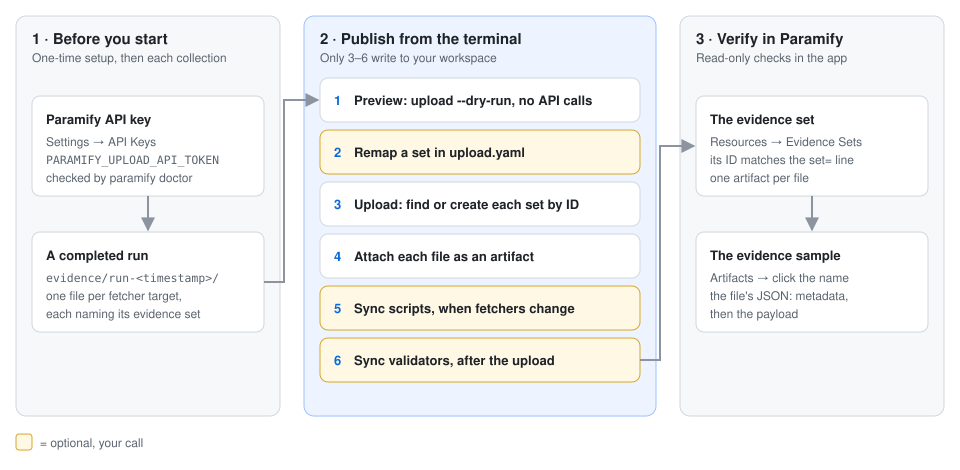
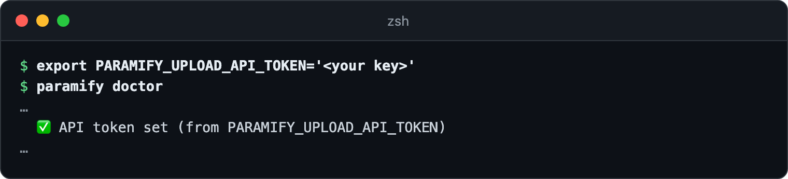
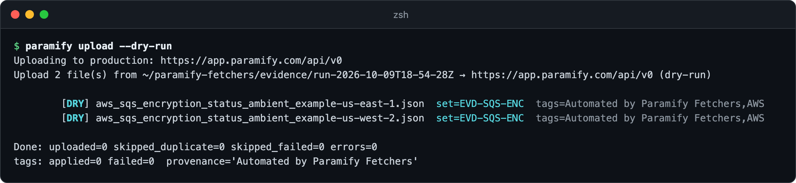
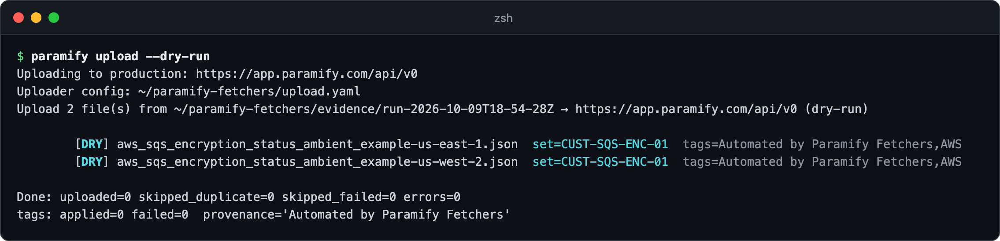
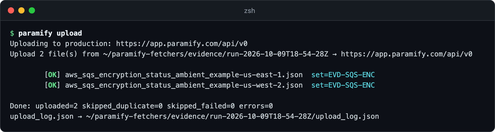
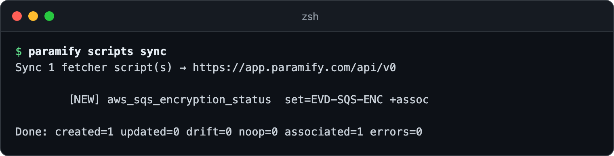
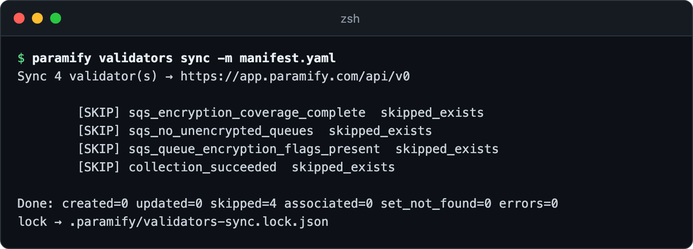
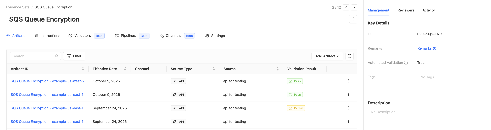
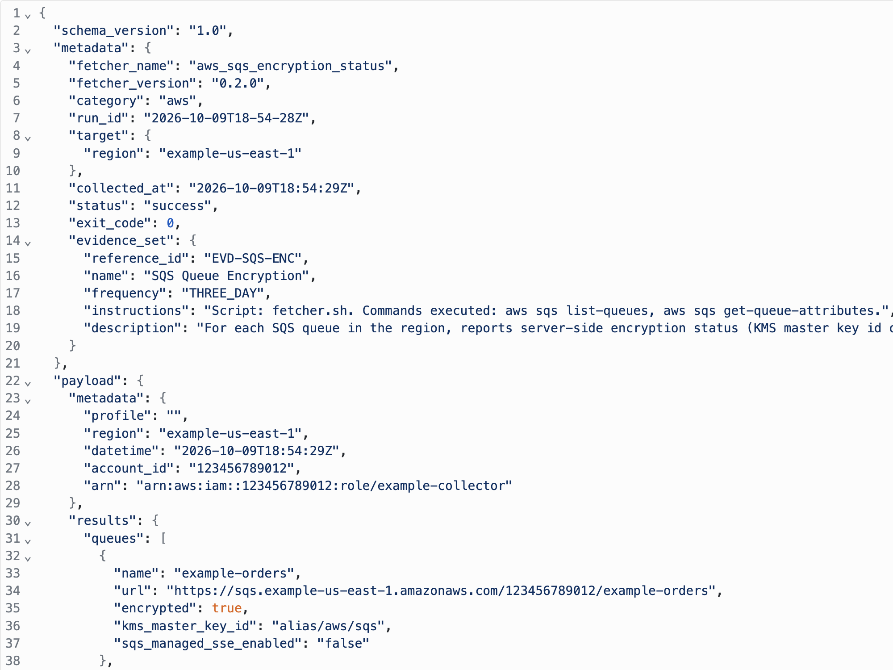

# Publishing a run to Paramify with `paramify upload`

`paramify upload` sends a completed run's evidence to Paramify. It sends the
files of each fetcher entry as one batch on that fetcher's evidence set. The
upload creates the set the first time it sees it. You can then sync each
fetcher's script and validators to the same set, and check the evidence in the
app. When the workspace cannot use batches, the upload sends each file direct,
as it did before batches. See
[When a batch cannot be used](#when-a-batch-cannot-be-used).



**You need:** [the repo installed](../README.md#install) ·
[a completed run](cli_guide.md#collect-then-upload) · a Paramify account that
can create API keys. The TUI's **Paramify** tab does the same upload and script
sync ([TUI walkthrough](https://support.paramify.com/hc/en-us/articles/55867428958355-Setup-Fetchers)).

---

## 1. Set your API key

Create a key with the permissions in
[API key setup](../uploaders/paramify_evidence/README.md#paramify-api-key)
([help-center steps](https://support.paramify.com/hc/en-us/articles/43292803890451-Create-a-Paramify-API-Key)),
then export it. `paramify doctor` confirms it's set. Uploads also read `.env` at
the repo root, but `paramify doctor` doesn't.



<details><summary>Copy the commands</summary>

```bash
export PARAMIFY_UPLOAD_API_TOKEN='<your key>'
paramify doctor
```
</details>

## 2. Preview the upload

`--dry-run` reads the newest run and lists each file with the evidence set it
will land on. It makes no API calls and needs no key. It cannot read the
workspace, so the stack, channel and artifact request show as unknown. Check the
destination on the first line and each `set=`. To upload an older run, pass its
directory.



<details><summary>Copy the command</summary>

```bash
paramify upload --dry-run
```
</details>

To see where each batch would go, run `paramify upload --plan`. It reads the
workspace (it makes no changes) and prints the full plan: for each fetcher entry,
the evidence set, stack, channel, artifact request, and whether the batch is
new, resumed or already done. It also lists the files it drops and any open
batches from earlier runs. It needs your key. The upload prints the same plan
before it applies it. [How the plan decides](#how-a-run-is-delivered) is below.

## 3. Use your own evidence set (optional)

If your program already tracks this evidence under its own reference ID, map
the fetcher to it in `upload.yaml` at the repo root
([all options](../examples/upload.yaml)). Script sync reads the same file, so
scripts follow the evidence. Re-run the [preview](#2-preview-the-upload) to check
the new `set=`.

```yaml
overrides:
  aws_sqs_encryption_status:
    reference_id: CUST-SQS-ENC-01
```



### Set the collection frequency

The collection frequency is how often Paramify expects a new artifact on a set.
It is not a count of your uploads. When the upload creates a set, it sets the
frequency to `THREE_DAY` and starts the schedule on that day. To use a different
frequency, add `frequency` to the fetcher in `upload.yaml`:

```yaml
overrides:
  aws_sqs_encryption_status:
    frequency: DAILY
```

The values are `DAILY`, `THREE_DAY`, `WEEKLY`, `BIWEEKLY`, `MONTHLY`,
`QUARTERLY`, `BIANNUAL`, `ANNUAL` and `NOT_SET`. `DAILY` is the shortest, so use
it when you upload more than once a day.

- **Only new sets get it.** The upload writes the frequency when it creates the
  set. It never changes the frequency of a set that exists, so a change that you
  make in the app stays.
- **One entry for each fetcher.** No setting applies to all fetchers. To set
  every fetcher to `DAILY`, add an `overrides` entry for each one.
- **Check the key name.** The upload ignores an unknown key, for example
  `frequncy`, and gives no warning.
- **Scheduled uploads need `--config`.** `deploy/run-and-upload.sh` does not read
  `upload.yaml` by default ([troubleshooting](#troubleshooting)).

**To change sets that exist,** edit the frequency on each set in the app, or use
the API. Each run's `upload_log.json` lists the sets that the upload used. This
loop sets all of them to `DAILY`:

```bash
jq -r '.. | objects | select(has("evidence_id")) | .evidence_id' \
  evidence/run-*/upload_log.json | sort -u |
while read -r id; do
  curl -s -X PATCH "${PARAMIFY_API_BASE_URL:-https://app.paramify.com/api/v0}/evidence/$id" \
    -H "Authorization: Bearer $PARAMIFY_UPLOAD_API_TOKEN" \
    -H "Content-Type: application/json" \
    -d '{"frequency": "DAILY"}' -o /dev/null -w "$id %{http_code}\n"
done
```

Each line shows a set ID and the HTTP status. `200` is a success. `403` means
that the key does not have **Write Evidences**.

## 4. Upload

Run it without `--dry-run`. Each file shows `OK`, plus `channel=` when its set
has a channel. Then each batch shows its state. Paramify approves it, or it
waits for review, or a validator holds it.



<details><summary>Copy the command</summary>

```bash
paramify upload
```
</details>

**Uploading the same run again changes nothing.** The upload finds the batch it
made for that run and leaves it alone, and files already sent show `SKIP`
(`skipped_duplicate`). A new run makes a new batch. To collect and upload on a
schedule, [run it in a container](../deploy/README.md#4-run-it-on-a-schedule).
`deploy/run-and-upload.sh` uploads the run it just collected. Add a second
argument to name the stack.

## How a run is delivered

**One batch per fetcher entry per run.** A batch is a set of artifacts that
Paramify submits and approves as one unit. All the targets of one entry go in the
same batch. Two entries that use the same fetcher get two batches. The solution
capability reads the most recent approved batch whose validators pass.

**An upload of the same run again sends nothing twice.** This is also true for a
run that an earlier uploader sent before batches existed. Its files are already
on the set, so the upload does not send them again.

**Channels decide the route.** For each entry the upload counts the channels on
the evidence set:

| The set has | The upload does |
|---|---|
| No channel | Sends the batch to the evidence set. |
| One channel | Uses it. It refuses when a stack is set and the channel is on a different stack. |
| Several channels | Needs a stack. It uses the channel on that stack. It refuses when no stack is set, the stack is not in the workspace, no channel is on that stack, or two are. |

Channels exist only in the Paramify app. The upload never creates one.

**The artifact request.** On a channel, the batch goes to the current artifact
request. If there is none, it goes to the most recent past request and the plan
warns of a late submission. If the channel has no request at all, the upload
sends the entry direct. See
[When a batch cannot be used](#when-a-batch-cannot-be-used). To send a batch to
the evidence set instead, set `no_request: evidence` on the entry. Those
artifacts do not count toward the solution capability.

**A refusal stops one entry.** The other entries still upload. Each refusal says
what to change. The run exits 1, and `upload_log.json` shows the entry as
`refused`.

### Choose the stack in the manifest

Set the stack, and the other delivery options, under `run.paramify` in the run
manifest. An entry can override each one.

```yaml
run:
  paramify:
    stack: <stack id>          # an id, or a name
    stack_name: Production     # a label only
    approval: SUBMISSION_WITH_PASSING_VALIDATORS
  fetchers:
    - use: aws_iam_mfa
    - use: okta_phishing_resistant_mfa
      paramify:
        stack: GovCloud
        approval: MANUAL
        no_request: refuse
```

| Key | Values | Meaning |
|---|---|---|
| `stack` | stack id or name | The stack whose channel receives the batch. |
| `stack_name` | text | A label. The plan warns when it no longer matches the workspace. |
| `owner` | Paramify username | Whose channel receives the batch when the stack has one channel per owner. |
| `approval` | `SUBMISSION` (default), `SUBMISSION_WITH_PASSING_VALIDATORS`, `MANUAL` | How Paramify approves each batch this upload creates, and a set it creates. |
| `no_request` | `direct` (default), `evidence`, `refuse` | What to do when a channel has no artifact request. |
| `delivery` | `auto` (default), `direct` | `direct` sends the entry direct, with no batch. |

`paramify run` writes each entry's settings into the run's `_run_metadata.json`.
The upload reads them from there. A manifest that changes after the run does not
change the upload, and a scheduled container needs no manifest.
When the manifest now sets a different value, the plan gives a note for each
difference.

List the stacks with `paramify stacks`. Store one in a manifest with
`paramify manifest set-stack MANIFEST STACK`. Add `--fetcher NAME` to set it for
one entry. To override the stack for one upload, run
`paramify upload --stack STACK`.

#### Owner

Paramify makes one channel for each owner on each stack. So an evidence set can
have two channels on the same stack, one for each owner. The stack alone cannot
choose between them. The `owner` setting chooses the channel of that owner.

The upload reads the owner only in this case. When the stack has one channel,
the upload uses it, whoever owns it. So you can set one owner for the whole
manifest. Sets with one channel are not changed.

- When no channel on the stack has the owner, the upload refuses the entry. The
  message lists the owners on that stack.
- The owner does not choose a stack. A set with channels on several stacks
  still needs a stack.
- The match ignores case.

Store an owner with `paramify manifest set-owner MANIFEST USERNAME`. Add
`--fetcher NAME` to set it for one entry. With a token, the command checks the
name against the owners of the workspace's channels. To override the owner for
one upload, run `paramify upload --owner USERNAME`.

### When a batch cannot be used

Some entries cannot go in a batch. The upload then sends them direct. Direct is
the route the uploader used before batches. It sends each file to the evidence
set. It makes no batch, no submit and no approval. It keeps the channel and
stack routing, so each file carries the id of the channel. It also keeps the
run identity, so you can upload the same run again and nothing goes twice.

The upload sends an entry direct in these cases:

| Case | Plan reason |
|---|---|
| The workspace does not have batches, or the token cannot read them. `GET /batches` answers 404, or 403 for any reason (for example `Artifact requests are not enabled for this workspace.`). A 401 still stops the upload. | `batches are off for this workspace` |
| The channel has no artifact request, and `no_request` is `direct`. | `<channel> has no artifact request` |
| The entry sets `delivery: direct`. | `delivery: direct` |

When the workspace does not have batches, the plan starts with one note:
`batches are off for this workspace (<detail>); every entry is sent direct, as
before batches`. `<detail>` is the message of the API, or `the API has no batch
routes` for a 404. The upload reads no artifact request and no batch after the
check. An offline `--dry-run` makes no check and shows no note.

Each direct entry shows a line like this in the plan:
`deliver 2 files to EVD-12 direct (channel CH-1): batches are off for this workspace`.
A set with no channel shows `(no channel)`. A channel with no request also gives
the warning `<channel> has no artifact request; sent direct, as before batches`.

Set the behavior in the manifest, on `run.paramify` or on one entry:

```yaml
run:
  paramify:
    delivery: auto          # the default: use a batch when one is possible
    no_request: direct      # the default: send direct when the channel has no request
  fetchers:
    - use: aws_iam_mfa
      paramify:
        delivery: direct    # always send this entry direct
    - use: okta_phishing_resistant_mfa
      paramify:
        no_request: refuse  # refuse this entry instead
```

A [pipeline fetcher](pipeline_fetchers_guide.md)'s entry ignores a `direct` it
inherits from `run.paramify`: it uses `delivery: auto` and `no_request:
evidence`, and `paramify validate` notes it. Set on the entry itself, `direct`
is a validate error.

| `no_request` | Result when the channel has no artifact request |
|---|---|
| `direct` (default) | Sends the entry direct, with a warning. |
| `evidence` | Sends a batch to the evidence set. These artifacts do not count toward the solution capability. |
| `refuse` | Refuses the entry. |

The result and `upload_log.json` record each entry's `mode`: `batch`,
`direct`, or null. The mode is null when the upload did not route the entry:
a refused entry, an entry with no file to send, or an entry in a dry run. A
direct entry has no batch id. A temporary failure holds only that file, and the
next upload sends only that file. A direct artifact is not on a batch. Paramify
decides whether it counts toward the solution capability.

When a workspace gets batches later, the files that the upload sent direct read
as delivered. A new run goes in a batch.

### Approval mode

Each batch the upload creates gets the approval mode `SUBMISSION`. Paramify
approves the batch when the upload submits it, and no one reviews it. This is
so whatever mode the evidence set has. Set `approval` to change it:
`SUBMISSION_WITH_PASSING_VALIDATORS` holds a batch until its validators pass,
and `MANUAL` holds it for a person. A new evidence set gets the same mode. The
upload never changes an existing set: it only adds tags to it.

The plan says how each new batch is approved, for example
`new batch (approved on submit)`. A batch that an earlier upload made keeps its
mode. Paramify approves a batch a moment after the submit answers, so the
upload can report `SUBMITTED: approved on submission; not approved yet when
read back`. The batch needs nothing more.

A workspace whose API cannot set a batch's mode yet refuses it. The upload then
creates the batch without it, so the batch takes the set's mode, and the entry
gives a warning.

When you set `approval` and an existing set uses a different mode, the plan
shows a note. When the upload must create a set, all the entries that send to
it must have the same `approval`. If they do not, the upload refuses that set.
Entries that send to an existing set can have different values.

### Held and dropped files

| Problem | Result |
|---|---|
| A temporary failure (429, 5xx, network) | The batch stays `OPEN` and the entry is `held`. Run the same upload again. It sends only the missing files, then submits. |
| A permanent failure on one file (the production WAF, 413, another 4xx) | The upload drops that file, submits the rest, and names the dropped file. The entry is `delivered_with_drops`. |
| A later upload of the same run, when its batch is submitted or approved without a dropped file | The upload sends nothing. It names the file as dropped (`not in submitted batch …`), not as a duplicate. Fix the cause and collect again to send it. |
| The API refuses a write (400, 405, 415, 422) for one evidence set or batch | That set or entry fails, with the message from the API. The other entries still upload. Only a 401 or 403 stops the whole upload. |
| The API refuses a tag | The upload sends the evidence without the tag and shows a warning. |

A dropped file counts in `dropped`, not in `errors`. It does not change the
exit code. When the upload drops every file of an entry, the entry fails and
counts one error.

A file that cannot be read, is not an envelope, or has no complete evidence set
is an error. The upload names it and still sends the other files of the entry.
The entry shows `delivered_with_drops`, `errors` counts the file, and the run
exits 1. A file that `skip_failed` skips, or an incomplete inventory, is only
skipped: it does not change the exit code.

Run `paramify upload --plan` to see held batches and open batches from earlier
runs.

### Read the result

`paramify upload --json` and `upload_log.json` keep `uploaded`,
`skipped_duplicate`, `skipped_failed`, `errors` and `ok`, and add:

- `dropped`: the number of files the upload dropped. `errors` does not count
  them. `ok` is true only when `errors` is 0.
- `plan`: the actions the upload planned.
- `entries`: one record for each fetcher entry, with its `state`
  (`planned` for a dry run, then `delivered`, `delivered_with_drops`, `held`,
  `refused`, `failed` or `noop`), `mode` (`batch`, `direct` or null), batch id,
  status, stack, channel and artifact request.
- `outcomes`: what each action did.
- `batches`: whether the workspace has batches. In a dry run, it is null. It is
  also null when the check for batches failed and stopped the upload. Otherwise,
  it is `{"available": true or false, "reason": text or null}`.
- `validators`: the validator sync summary, when you pass `--with-validators`.
  With `--dry-run`, it names the sync that the upload would do.

The `results` list no longer holds `evidence_id`, `artifact_id` or `channel_id`
for each file. A dropped file has the outcome `dropped`. Read the batch and its
channel from `entries`. The exit code is 0 when every entry was delivered (with
or without dropped files) or needed no change, and 1 otherwise.

**A failed validator sync stops the upload.** With `--with-validators`, the
upload syncs the validators before it sends a batch. If the sync fails, the
upload sends no batch for any entry of the run, and the run exits 1. Correct the
sync problem, then run the same upload again.

## 5. Sync scripts and validators (optional)

**Scripts** show in Paramify how the evidence was collected. Run this when you
add a fetcher or bump its version, not after every collection. It covers the
fetchers in `manifest.yaml`; name another manifest, or pass `--all`
([what it does](../uploaders/paramify_scripts/README.md#what-it-does-per-fetcher)).



<details><summary>Copy the command</summary>

```bash
paramify scripts sync
```
</details>

**Validators** from the registry check each new artifact. Sync them after the
upload, because a validator attaches only to a set that exists
([how sync works](../uploaders/paramify_validators/README.md#what-it-does-per-validator)).
`-m` limits it to your manifest's sets. To write your own, see
[authoring validators](suggest_validator_guide.md).

**Watch for `skipped_exists`.** The validator was already in the workspace, so
the sync didn't attach it again. Check the set's **Validators** tab.



<details><summary>Copy the command</summary>

```bash
paramify validators sync -m manifest.yaml
```
</details>

## 6. Verify in Paramify

Go to **Implementation → Evidence Sets** and open *SQS Queue Encryption*. **Key
Details** shows the ID from the `set=` line, and the **Artifacts** tab has one
artifact per uploaded file.



**Click an artifact's name** to see exactly what was uploaded: the file's
`metadata` (fetcher, run, target, status) above its `payload`. For validation
results, see [verify validators](suggest_validator_guide.md#5-verify-in-paramify).



---

## Troubleshooting

| Symptom | Fix |
|---|---|
| `[FAIL]` with `401` or `403` | Check the key's permissions ([step 1](#1-set-your-api-key)) and that `PARAMIFY_API_BASE_URL` points where the key was made. |
| `No run under ./evidence that collected evidence.` | Your manifest writes elsewhere. Add `-f <manifest>`, or pass the run directory. |
| `… has 3 channels and no stack is configured` | The upload does not guess a channel. Set the stack: `paramify manifest set-stack`, or `paramify upload --stack`. The message lists the stacks. |
| `… has no channel on stack …` | Create a channel for that stack on the evidence set in the app, or choose another stack. |
| `… has 2 channels on stack …, one per owner: …` | Paramify makes one channel for each owner on a stack, and no owner is set. Set one: `paramify manifest set-owner`, or `paramify upload --owner`. The message gives the owner of each channel. See [Owner](#owner). |
| `… has no channel on stack … owned by …` | The owner you set has no channel on this set's stack. Set one of the owners that the message lists, or set this entry's own owner with `--fetcher`. |
| `no current or past artifact request on channel …` | This appears only with `no_request: refuse`. Create an artifact request on the channel in the app, or remove `no_request: refuse` from this entry to send it direct. |
| `batches are off for this workspace (…); every entry is sent direct, as before batches` | This is a note, not an error. The workspace has no batches, so the upload sends every entry direct. |
| An entry shows `held` | A temporary failure stopped the batch. Run the same upload again. |
| `… was rejected in Paramify; collect again to send new evidence` | A person rejected this run's batch in the app. The upload does not send the same evidence again. Collect again: the new run makes a new batch. |
| A file shows `blocked by the production WAF` | The evidence holds a string the WAF rejects (`../`, `/bin/sh`, `<script`). The upload sent the rest. Remove the string and collect again. |
| Validators attach to `EVD-…`, not your remapped set | Validator sync uses the registry's reference IDs. Attach them on the set's **Validators** tab → **Manage Selection**. |
| `No fetchers in the manifest …` from `scripts sync` | It found none in `manifest.yaml` at the repo root. Name your manifest, or pass `--all`. |
| The run also collected scan reports | `paramify upload` sends evidence only. Send reports with the [issues uploader](../uploaders/paramify_issues/README.md). |

**More detail:** [upload options](../uploaders/paramify_evidence/README.md#config---config-optional)

**A pipeline file is the exception.** A file from a [pipeline
fetcher](pipeline_fetchers_guide.md), such as an inventory, never goes direct
while the workspace has batches: a direct upload is stored and builds nothing.
With no artifact request it goes in an evidence-level batch on the set. A
manifest entry with `delivery: direct` or `no_request: direct` on the entry itself
is refused; the same setting inherited from `run.paramify` is ignored. When
the workspace has no batches, the file is sent direct with the note `sent direct:
this workspace has no batches; the pipeline runs the pre-batch way`, and `--json`
shows `pipeline.approved: null`.
