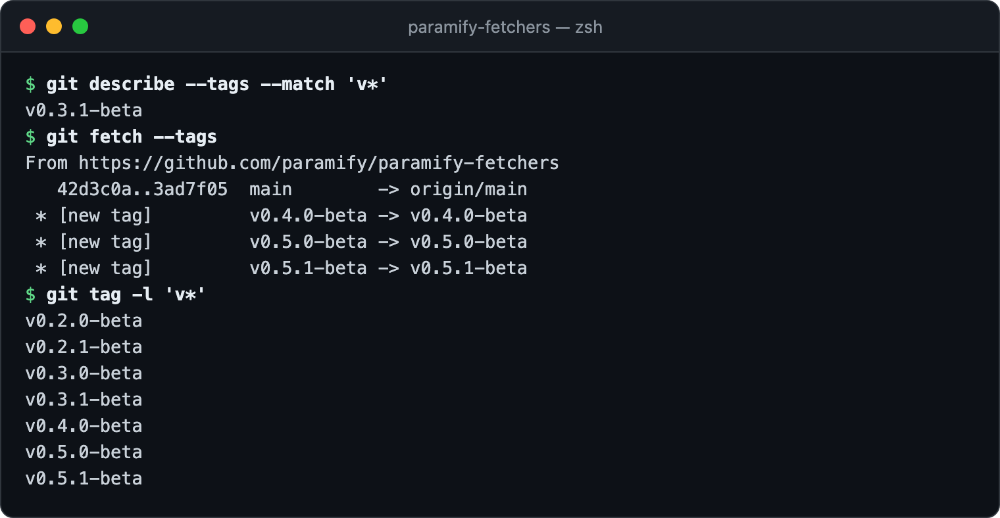
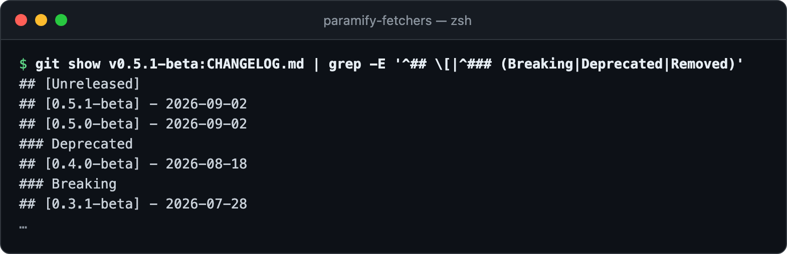
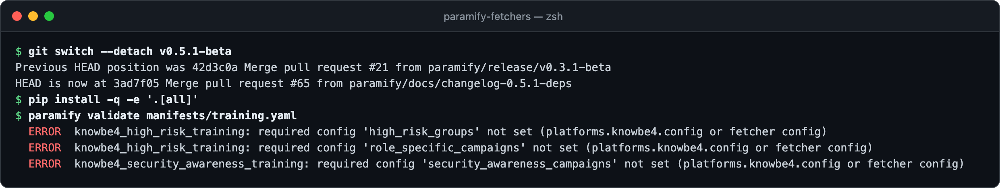

# Updating safely, on main or a pinned release

`paramify update` brings your clone up to date. It tells you which of the
fetchers you use change, checks your manifests against the new code before it
touches your checkout, then moves, reinstalls if it needs to, and validates.

There are two ways to run, and update follows whichever your clone is on:

| You run | `paramify update` moves you to |
|---|---|
| `main` (what `git clone` gives you) | the newest `main`, by fast-forward |
| A pinned release, such as `v0.7.0-beta` | the newest release |

**You need:** [a clone installed from source](../README.md#install). Private
copy? [Merge each release](private_mirror_guide.md#3-merge-each-paramify-release)
instead. Container? [Update the clone, then rebuild](#in-a-container).

---

## Update with `paramify update`

```bash
paramify update
```


In order, it:

1. Fetches from origin and works out the target from what your clone is on.
2. Checks the target out in a temporary `git worktree`, runs the target's own
   `paramify validate` on each of your manifests, and removes the worktree. A
   manifest that fails there and passes today **would break**.
3. Shows what changes for you:
   - **Your fetchers:** each fetcher your manifests use that changed, with its
     version before and after. If a release gave a note for the fetcher, you
     see the notes, newest release first (three at most). If not, you see the
     reason a commit gives.
   - **Breaking:** the breaking changes that touch this clone, each with its
     fix and the manifests it affects.
   - **New:** up to ten highlights, grouped under the release that shipped
     them. Changes that are not in a release yet come first, under
     "unreleased".
   - One line counting everything else, and a link to the full changelog.
4. Asks before it changes anything (`[y/N]`).
5. Fast-forwards your branch, or switches to the release tag.
6. Reinstalls with the same Python and the extras you have, but only when
   `pyproject.toml` changed. Most updates on `main` skip this and take seconds.
7. Validates each manifest again.

| Command | Does |
|---|---|
| `paramify update` | Bring the clone up to date with what it follows. |
| `paramify update --to v0.7.0-beta` | Pin that release, older or newer. |
| `paramify update --to main` | Stop pinning and follow `main` again. |
| `paramify update --check` | Only report. Exit 0 up to date, 1 an update is waiting, 2 can't tell. |
| `paramify update --rollback` | Go back to where you were before the last update. |
| `--yes` | Don't ask. It still stops when the update would break this clone, unless you add `--allow-breaking`. |
| `--json` | The whole plan and result as JSON. Without `--yes` it plans and exits 1 without moving. |

**What stops a `--yes` run.** A manifest that would break, or a breaking change
that touches this clone: one that names a fetcher your manifests use, one
about fetchers you wrote yourself (when you have some), or one that is about
everyone, such as a new minimum Python. Breaking changes for fetchers you
don't use are counted, not listed, and don't stop anything.

**Pinning needs a release that has `paramify update` in it.** Releases up to
0.6.0-beta were cut before this command existed, so `--to` refuses them: you
could not update or roll back from there. It prints the `git switch` command
if you want one anyway.

**Your local changes ride along.** Update stops only for a file you changed
that the update changes too, or a file of yours sitting where the update adds
one. It lists them. Your own fetcher directories and `manifests/` stay where
they are.

**It never merges.** If your branch has commits its remote branch lacks,
update says so and stops. Push or move them first.

**Changed your mind?** `paramify update --rollback` returns to the commit
recorded in `.paramify/state.json` (which git ignores). On `main` you stay on
`main`, one update behind, and the next `paramify update` moves you forward
again. Rollback refuses if the clone has moved since the update (you committed
or switched), because going back would discard that work.

**Exit codes for scripts.** 0 means the clone is up to date and every manifest
that passed before still passes. 1 means it refused, failed, or moved but a
manifest now fails on the new code (the JSON has `switched: true` and
`ok: false`). If the reinstall fails, update puts the old code back and
reports `reverted: true`.

**You hear about updates on their own.** After a command, `paramify` prints
one dim line when something is waiting ("12 new commits on main"): at most
once a day, never with `--json`, never into a pipe. It fetches in the
background, so it never waits on the network. Set `PARAMIFY_NO_UPDATE_CHECK=1`
to turn it off.

### In a container

The image is built from your clone, with no git history in it. Inside it,
`paramify update` explains this and prints the two commands to run on the host:

```bash
paramify update                                     # in your clone, on the host
docker compose -f deploy/docker-compose.yml build   # rebuild the image
```

---

## Upgrade by hand

`paramify update` first ships after 0.6.0-beta. A clone that doesn't have it
yet gets it with one `git pull` on `main`, or by hand as below when it is
pinned to an older release. These steps are also the fallback if update can't
run.


## 1. See where you are

Fetch the release tags. `git describe` names the one you're on.



<details><summary>Copy the commands</summary>

```bash
git describe --tags --match 'v*'
git fetch --tags
git tag -l 'v*'
```
</details>

## 2. Read what changed

Read every release between yours and the target, and act on each **Breaking**,
**Deprecated**, and **Removed** section:



<details><summary>Copy the command</summary>

```bash
git show v0.5.1-beta:CHANGELOG.md | grep -E '^## \[|^### (Breaking|Deprecated|Removed)'
```
</details>

Here, `0.4.0-beta` made three KnowBe4 settings required. What each bump means:

| Bump | For you |
|---|---|
| Major | A manifest field, CLI flag, or fetcher output you use can break. |
| Minor | New fetchers and options. **Before 1.0, a minor can also break.** |
| Patch | Fixes and dependency bumps. |

## 3. Switch, reinstall, validate

Switch, reinstall with [your extras](../README.md#install), and validate each
manifest. **Skipping the reinstall can fail with `ModuleNotFoundError`**:
releases add dependencies.



<details><summary>Copy the commands</summary>

```bash
git switch --detach v0.5.1-beta
pip install -q -e '.[all]'
paramify validate manifests/<your manifest>.yaml
```
</details>

Set what it names as the entry says
([manifest commands](cli_guide.md#building-a-manifest)), then validate again.

---

## Troubleshooting

| Symptom | Fix |
|---|---|
| `git describe` prints `v0.5.1-beta-291-g59a2387` | You're on `main`, 291 commits past that release. That's fine: `paramify update` follows `main`. |
| A run breaks after updating | `paramify update --rollback`. |
| update says your branch has commits its remote doesn't | It only fast-forwards. Push them, or move them to another branch. |
| update says the clone is on a detached commit | `paramify update --to main`, or `--to <tag>` to pin a release. |
| update says it stopped | You ran it with `--yes` or `--json` and something touches this clone. Read it, then add `--allow-breaking`. |
| update says a manifest would break | It names the error. Fix the manifest first, or update and fix it after. |

**More detail:** [how releases are cut](releasing_guide.md) ·
[release highlights](../releases/README.md) · [CHANGELOG](../CHANGELOG.md)
