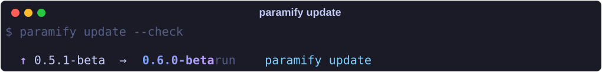
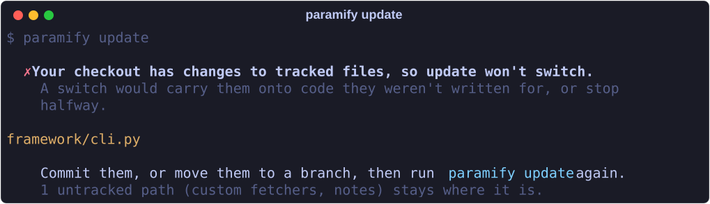
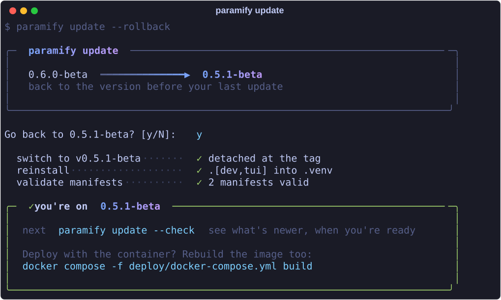
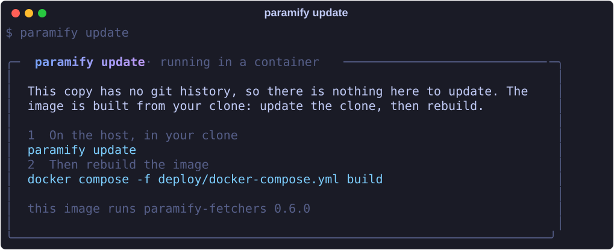
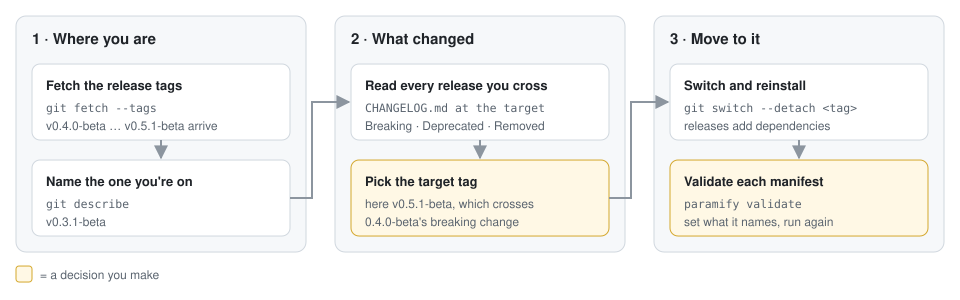

# Pinning a release and upgrading safely

Run a release tag, not `main`. `paramify update` moves you to a newer one: it
shows what changed, checks your manifests against the new version before it
touches your checkout, then switches, reinstalls and validates.

**You need:** [a clone installed from source](../README.md#install). Private
copy? [Merge each release](private_mirror_guide.md#3-merge-each-paramify-release)
instead. Container? [Update the clone, then rebuild](#in-a-container).

---

## Upgrade with `paramify update`

```bash
paramify update
```


In order, it:

1. Fetches the tags and picks the newest release. Releases are `vX.Y.Z-beta`
   tags; it never offers `main` or an `archive/*` tag.
2. Shows that release's highlights (`releases/<version>.yaml`), or a link to
   its CHANGELOG section if it has none. Every breaking change you cross is
   listed with its fix and the manifests it affects. Changes that only touch
   fetchers your manifests don't use fold into one line.
3. Checks the new version out in a temporary `git worktree`, runs that
   version's own `paramify validate` on each of your manifests, and removes
   the worktree. A manifest that fails there and passes today **would break**.
4. Lists which fetchers you use changed, and counts the rest.
5. Asks before it changes anything (`[y/N]`).
6. Runs `git switch --detach <tag>`, reinstalls with the same Python and the
   extras you have installed (`.[all]` if it can't tell), and validates each
   manifest again.

| Command | Does |
|---|---|
| `paramify update` | Move to the newest release. |
| `paramify update --next` | Move one release forward, to read each release's breaking changes in turn. |
| `paramify update --to v0.6.0-beta` | Move to that release, older or newer. |
| `paramify update --check` | Only report. Exit 0 up to date, 1 an update is available, 2 can't tell. |
| `paramify update --rollback` | Go back to the version you ran before the last update, and reinstall. |
| `--yes` | Don't ask. With breaking changes or a manifest that would break, it still stops unless you add `--allow-breaking`. |
| `--json` | The whole plan and result as JSON. Without `--yes` it plans and exits 1 without switching. |



**It won't switch over local changes.** If git tracks a file you changed,
update lists it and stops: commit it, or move it to a branch. Untracked files,
such as your own fetcher directories and `manifests/`, stay where they are.



**Changed your mind?** `paramify update --rollback` returns to the version
recorded in `.paramify/state.json` (which git ignores), and reinstalls.



**A newer release shows up on its own.** After a command, `paramify` prints
one dim line when a newer release tag exists: at most once a day, never with
`--json`, never into a pipe. It fetches tags in the background, so it never
waits on the network. Set `PARAMIFY_NO_UPDATE_CHECK=1` to turn it off.

### In a container

The image is built from your clone, with no git history in it. Inside it,
`paramify update` explains this and prints the two commands to run on the host:

```bash
paramify update                                     # in your clone, on the host
docker compose -f deploy/docker-compose.yml build   # rebuild the image
```



---

## Upgrade by hand

`paramify update` first ships after 0.6.0-beta, so moving off 0.6.0-beta or
older is done by hand once. These steps are also the fallback if update can't
run.



## 1. See where you are

Fetch the release tags. `git describe` names the one you're on.


<details><summary>Copy the commands</summary>

```bash
git describe --tags --match 'v*'
git fetch --tags
git tag -l 'v*'
```
</details>

## 2. Read what changed

Read every release between yours and the target, and act on each **Breaking**,
**Deprecated**, and **Removed** section:


<details><summary>Copy the command</summary>

```bash
git show v0.5.1-beta:CHANGELOG.md | grep -E '^## \[|^### (Breaking|Deprecated|Removed)'
```
</details>

Here, `0.4.0-beta` made three KnowBe4 settings required. What each bump means:

| Bump | For you |
|---|---|
| Major | A manifest field, CLI flag, or fetcher output you use can break. |
| Minor | New fetchers and options. **Before 1.0, a minor can also break.** |
| Patch | Fixes and dependency bumps. |

## 3. Switch, reinstall, validate

Switch, reinstall with [your extras](../README.md#install), and validate each
manifest. **Skipping the reinstall can fail with `ModuleNotFoundError`**:
releases add dependencies.


<details><summary>Copy the commands</summary>

```bash
git switch --detach v0.5.1-beta
pip install -q -e '.[all]'
paramify validate manifests/<your manifest>.yaml
```
</details>

Set what it names as the entry says
([manifest commands](cli_guide.md#building-a-manifest)), then validate again.

---

## Troubleshooting

| Symptom | Fix |
|---|---|
| `git describe` prints `v0.5.1-beta-291-g59a2387` | You're on `main`, 291 commits past it. `paramify update` offers the newest tag. |
| A run breaks after upgrading | `paramify update --rollback`, or switch back to your old tag and reinstall. |
| update says it stopped at breaking changes | You ran it with `--yes` or `--json`. Read them, then add `--allow-breaking`. |
| update says a manifest would break | It names the error. Fix the manifest first, or switch and fix it after. |

**More detail:** [how releases are cut](releasing_guide.md) ·
[release highlights](../releases/README.md) · [CHANGELOG](../CHANGELOG.md)
